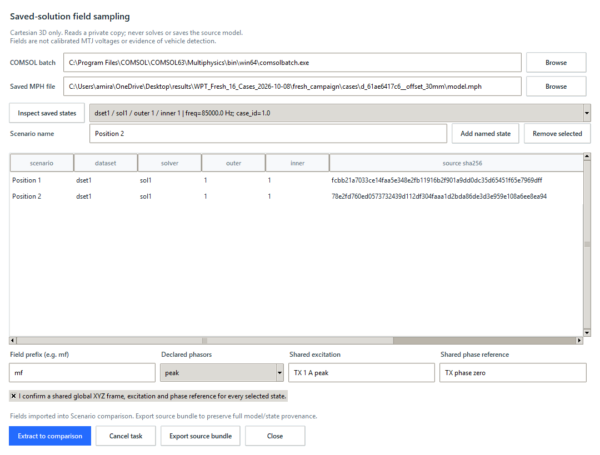
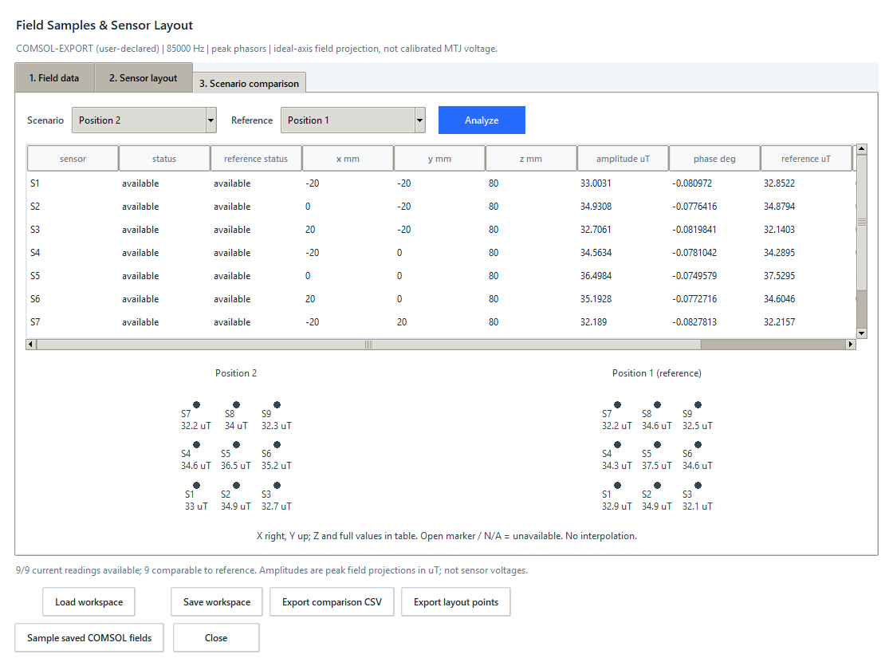

# Saved-solution field sampling

This guide covers two separate workflows: replaying an included saved result
without COMSOL, and reading fields from your own already-solved model using a
local COMSOL installation. Neither workflow runs a new solve.

## Start here

Use Python 3.10 or newer. For native windows, Tk must be available (normally
included with standard Windows Python). From a source checkout on Windows:

```powershell
python -m venv .venv
.\.venv\Scripts\python.exe -m pip install -e .
```

If the project environment already exists, use it rather than creating another.
The commands below do not require PowerShell activation or a browser. A source
checkout is needed for the example scripts and datasets; the application wheel
alone does not include them.

### Replay the checked example without a solver license

```powershell
.\.venv\Scripts\python.exe examples/replay_saved_comsol_fields.py --desktop --output-dir artifacts
```

The isolated native comparison stays open until closed. **STORED COMSOL RESULT
REPLAY** means it reads the included checked CSV/workspace, not a live COMSOL
connection. It does not open an MPH file or use the production database.
For a display-free integrity/comparison check, use:

```powershell
.\.venv\Scripts\python.exe examples/replay_saved_comsol_fields.py --headless --output-dir artifacts
```

See the [worked example](../examples/saved_field_wpt/README.md) for the two
source cases, expected readings, hashes and actual native captures.

### Sample your own saved solution

You need an installed COMSOL batch executable, `comsolcompile` beside it,
compatible licenses, and an already-solved Cartesian 3D MPH model with one
geometry. For this workflow, follow [Desktop workflow](#desktop-workflow).
The original 2D/axisymmetric model is not automatically converted or supported.
For a scripted check with your own files, use
[Reproducible real-model check](#reproducible-real-model-check).

## Objective and approved scope

Connect the existing native Field Samples workspace to explicitly selected saved
COMSOL solution states. Evaluate Cartesian Bx/By/Bz at fixed sensor coordinates,
preserve complex phasors, compare named static scenarios, and retain source
identity. No study, mesh, parameter update, source-model save or new solve.
This is not an MTJ response, vehicle magnetic signature or dynamic controller.

## Design and contracts

Use the installed COMSOL compiler/batch runtime with a packaged Java helper;
there is no additional Python dependency. A private temporary model copy is the
only model loaded. The helper creates temporary result evaluations in memory,
never saves a model, and batch runs with `-nosave`.

Catalog only direct Solution datasets and explicit outer/inner indices with
their saved parameter values. Do not choose a dataset, physics prefix or state
implicitly. The first increment supports Cartesian 3D global coordinates only;
reject planar and axisymmetric datasets instead of inventing a coordinate map.
Expressions must be simple qualified component names, not arbitrary formulas.
Use COMSOL Interp evaluation at the requested coordinates, with extrapolation
disabled. No nearest-node substitution or spatial field-map interpolation by
the application. An unavailable point aborts the extraction with no partial
dataset replacing the current workspace.

COMSOL performs finite-element interpolation inside the saved solution at the
requested locations. This is distinct from displaying an invented continuous
field map between sensors. Positions entered in m are converted to the model's
declared geometry length unit before evaluation. Supported geometry units are
m, cm, mm, um and nm. Mixed/multiple geometries are rejected.

Record the MPH SHA-256, dataset/solver tags, outer/inner indices, parameter
values, expressions, units and sampling settings in a portable evidence file.
Use the existing CSV/JSON field schema unchanged; an evidence bundle associates
the raw field CSV and exact workspace with the richer source record by digest.
The field convention/excitation/phase reference remain explicit declarations.

## Structure and style

`comsol_field_sampling.py` owns validation and orchestration;
`SavedFieldSampler.java` is the bounded engine adapter;
`comsol_field_ui.py` owns the native connection panel.
Use frozen dataclasses, ValueError for invalid input and existing ttk styles.
Example selection: `SavedState("dset1", "sol1", 1, 2, 85000.0, "freq=85000 Hz")`.

## Verification

```powershell
.\.venv\Scripts\python.exe -m unittest discover -s tests -p "test_comsol_field*.py"
.\.venv\Scripts\python.exe -m unittest discover -s tests
.\.venv\Scripts\python.exe -m compileall -q src tests examples
.\.venv\Scripts\python.exe -m pip wheel . --no-deps --no-build-isolation --wheel-dir dist
```

Test invalid expressions/coordinates, stale source identity, explicit selection,
complex values, shape/nonfinite errors, atomic acceptance, subprocess failures,
timeouts, cancellation and native state invalidation. Live checks use existing
saved solutions only and compare source hashes before/after. Synthetic fixtures
must remain labeled synthetic. Included stored simulation exports must identify
their source evidence and be labeled replay when no engine is invoked.

## Boundaries

Always validate external files, engine output and user entries. Bound model
copy size, catalog counts, sensors, scenarios and process time. Keep subprocess
arguments separate, no shell, generated code or executable expressions from
user input. Original models and production queues are out of scope.
Ask before new solves, dependencies, format migrations or publication.

## Implementation order

1. Test and implement catalog/selection and isolated engine execution.
2. Test extraction and portable evidence bundle acceptance.
3. Integrate a native connection panel with background work and stale-result gates.
4. Verify with saved models, native checks, regression tests and package build.

## Research roadmap

Saved fields at known positions come first. Next: datasheet-backed MTJ response,
ground-truth-separated position datasets, baseline coil-selection comparison
with an agreed multi-coil model, then clearly labeled static-scenario replay.
Resolve vehicle magnetic signature versus charging-coil AC field with the team;
neither interpretation is inferred by the application.

## Official API references

- [Interp](https://doc.comsol.com/6.3/doc/com.comsol.help.comsol/comsol_api_results.52.075.html)
- [SolutionInfo](https://doc.comsol.com/6.3/doc/com.comsol.help.comsol/api/com/comsol/model/SolutionInfo.html)

## Desktop workflow

Start the installed native application without activating PowerShell scripts:

```powershell
.\.venv\Scripts\sim-assistant.exe desktop
```

1. Open **Runs > Field samples > Sensor layout**,
   and explicitly define fixed sensor positions/directions. Entry positions
   are in mm. The same global XYZ positions are used in every source model.
2. Choose **Sample saved COMSOL fields**. Select the installed `comsolbatch`
   executable; `comsolcompile` must be beside it. Select an already-solved MPH
   file. No server, browser or new Python dependency is required.
3. Choose **Inspect saved states**, wait for the catalog, and explicitly select
   the desired dataset/solver/outer/inner tuple. The list includes saved sweep
   parameters and frequency. Empty/unsupported models report an error; they do
   not trigger a solve. A flat inner sweep uses outer index 1 to mean no outer
   variation. Multiple stored frequencies cannot share this comparison.
4. Enter a unique scenario name, e.g. `Aligned` or `Offset 30 mm`, then **Add
   named state**. You may inspect another solved file and add its state. The
   table keeps each source hash separately. Changing the selected file clears
   its inspection catalog, not the deliberately added scenario list. Remove
   old scenarios explicitly if replacing a source file.
5. Enter a qualified field prefix, e.g. `mf` only if it is the correct physics
   tag in this model. The helper evaluates its Bx/By/Bz components, not an
   arbitrary formula. Declare peak or RMS, shared excitation and phase reference.
   Labels need 1-80 ASCII characters as in the Field Samples workspace.
6. Confirm shared coordinate frame, excitation and phase reference. Check saved
   parameters carefully: reciprocal TX-only and RX-only characterization cases
   are NOT different vehicle positions or the same operating excitation.
   A change of position means selecting a stored position state or another
   already-solved model; this action does not move or recompute the vehicle.
7. Choose **Extract to comparison**. The interface remains responsive. **Cancel
   task** rejects pending results; closing requests cancellation as well. Edits
   to source inputs or the owner layout/data while a task is running discard
   pending results. Timeouts: 120 s compilation and 300 s engine per source.
   Every sensor must have finite component values; otherwise the whole import
   is blocked and no partial field dataset is accepted.
8. After success, the existing **Scenario comparison** tab contains every
   sampled sensor, complex projections and current/reference changes. It
   defaults to first scenario as reference and last as current; choose others
   explicitly. These are field projections, not measured MTJ output.
9. Before closing the sampling window, choose **Export source bundle**. It
   creates a new directory containing `fields.csv`, `workspace.json`,
   `evidence.json` and a `COMPLETE` marker. The source record contains model
   hashes, exact states and saved parameters, expressions, sampling settings
   and declarations, with no absolute source paths. The JSON workspace can be
   loaded by the ordinary workspace loader. Keep all bundle files together:
   a workspace alone retains field data but not the full source-state record.
   Hashes detect accidental corruption; they do not authenticate a sender or
   certify a physical model. A directory without `COMPLETE` is incomplete.

### Choose the right export

| Action | Retained information | Reopen or inspect |
| --- | --- | --- |
| **Save workspace** in Field samples | Exact complex fields, declared metadata and sensor layout | **Load workspace**; full COMSOL source-state record is not included |
| **Export comparison CSV** in Field samples | Current/reference projections, changes, availability and metadata for every sensor | CSV reader; this is a report, not a model or workspace |
| **Export source bundle** in the sampling panel | Raw `fields.csv`, `workspace.json`, `evidence.json` and `COMPLETE` | Load the workspace for review and retain all files for source provenance |

Bundle fields are in tesla and coordinates in m. Sensor editor positions are
in mm; comparison amplitudes are in uT with the explicitly declared peak/RMS
convention. The displayed amplitude change is `abs(current) - abs(reference)`
after projection onto the sensor axis, not the magnitude of the complex vector
difference. A negative change means a smaller projection amplitude, not reversed
power flow or a calibrated sensor voltage.

Workspace loading does not restore a live COMSOL connection or the sampling
panel's source-file list. To extract again, inspect the original solved model
and explicitly add its states. Do not edit a recorded hash to bypass a stale
source or integrity check.

Limits: 2 GB per source model, 1-32 named states, 256 sensors, at most 10,000
samples and 5 MB engine output. Compressed input also has a 26,000-character
command-line budget; unusually large requests must be split. Each source loads
sequentially into a private temporary directory. Allow disk space for a source
copy and sufficient COMSOL memory; this is not a resource-budget guarantee.

## Troubleshooting

| Message or symptom | Action |
| --- | --- |
| COMSOL executable/compiler missing | Select `comsolbatch.exe` in the installed version's `bin/win64` directory; `comsolcompile.exe` must be beside it |
| No saved state or unsupported model | Use an already-solved Cartesian 3D, single-geometry model with direct Solution datasets; 2D/axisymmetric and unsupported saved-state structures are not guessed |
| No scenario added | Choose a catalog entry explicitly, provide a unique name, then **Add named state** |
| Apply sensor edits first | Apply or discard pending layout entry edits before extracting or exporting |
| Pending results discarded | Inputs, layout or dataset changed, or cancellation was requested; review current inputs and extract again |
| Nonfinite/outside-domain point | Check sensor coordinates, frame, model domain and expression prefix; no zero or nearest-node replacement is supplied |
| Mixed frequencies or incompatible declarations | Compare separate groups with the same frequency, excitation and phase reference; TX-only/RX-only cases are not position changes |
| Missing `COMPLETE`, bad digest or size limit | Retain the original bundle and re-export valid data; the example replay caps evidence JSON at 500 KB, while ordinary workspace loading has its own bounds |
| No display/Tk available | Use the replay's `--headless` check, or run native review on a workstation with Tk |
| Optional screenshot dependency unavailable | Omit `--capture-dir`; ordinary sampling and replay do not require Pillow |

The general **Check connection**, **Run now** and queue controls belong to the
simulation-running workflow. They are not prerequisites for this read-only
sampling panel. Use **Inspect saved states** here to read the saved catalog.

## Reproducible real-model check

Supply your own existing solved models, whose excitation/frame you have checked:

```powershell
.\.venv\Scripts\python.exe examples/check_saved_comsol_fields.py "C:\models\aligned.mph" "C:\models\offset.mph" --executable "C:\Program Files\COMSOL\COMSOL63\Multiphysics\bin\win64\comsolbatch.exe" --dataset dset1 --solver sol1 --outer 1 --inner 1 --prefix mf --convention peak --excitation "TX 1 A peak" --phase-reference "TX phase zero" --z-mm 80 --output-dir artifacts
```

The script samples a 3x3 grid, spacing 20 mm at the declared Z, and verifies
complex readings, workspace round trips, source hashes, complete CSV export and
native minimum/normal sizes. It uses an isolated temporary app database. It
does not create a demonstration solve. Optional `--capture-dir` uses Pillow on
Windows to capture actual native windows; ordinary checks need no Pillow.

## Verified saved WPT example

Rechecked on 2026-10-29 on Windows with COMSOL 6.3.0.290, using the existing solved aligned and
30 mm RX-offset cases from the same WPT design. Both explicitly selected
`dset1 / sol1 / outer 1 / inner 1`, with saved `freq=85000 Hz; case_id=1`.
The excitation declaration was `TX 1 A peak`, phase reference `TX phase zero`.
This is characterization-field evidence, not loaded operating-field evidence,
real hardware data or a vehicle-body magnetic-signature simulation.

- Position 1 (aligned) MPH SHA-256:
  `fcbb21a7033ce14faa5e348e2fb11916b2f901a9dd0dc35d65451f65e7969dff`
- Position 2 (30 mm RX offset) MPH SHA-256:
  `78e2fd760ed0573732439d112df304faaa1d2bda86de3d3e959e108a6ee8ea94`

The fixed +Z sensors use X/Y = -20, 0, 20 mm and Z = 80 mm in global coordinates.
All nine had finite complex Bx/By/Bz values in both cases. At the center sensor
S5 the +Z peak projection magnitude was 37.5295187133 uT aligned and
36.4984380917 uT offset (change -1.0310806216 uT). Source hashes matched after
reading. Full CSV export, exact JSON reload and both native window sizes passed.
An outside-domain location and the unsupported legacy model were rejected
without launching any solve or importing a partial dataset. Live coverage is
the flat inner sweep above; other saved-solution structures must pass the same
runtime validation and are not claimed to have equivalent live coverage.

These are actual application captures showing those saved-simulation readings:





The [included source bundle](../examples/saved_field_wpt/README.md) preserves
these checked fields without distributing the private MPH models. The separate
offline replay is visibly labeled and never invokes the COMSOL engine.

## Engine compatibility notes

The helper deliberately uses no Java filesystem read/write permissions beyond
COMSOL's model loader. Compressed, bounded arguments carry the sampling request;
a line-framed String response carries the output. Global COMSOL security
preferences are unchanged. In 6.3 flat inner sweeps, tuple-based SolutionInfo
parameter access rejected the saved model despite valid indices. For that
explicit no-outer-loop structure the helper uses SolverSequence parameter
accessors, not guessed default parameter values. Outer sweeps use SolutionInfo
tuple access and fail closed if the engine cannot provide consistent evidence.
