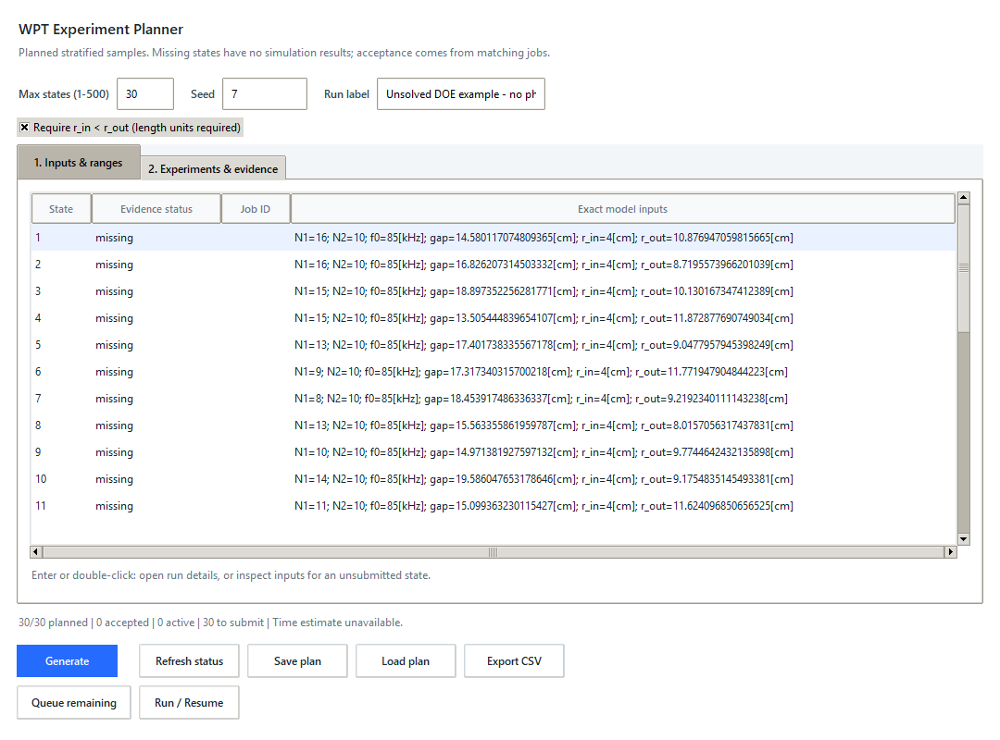
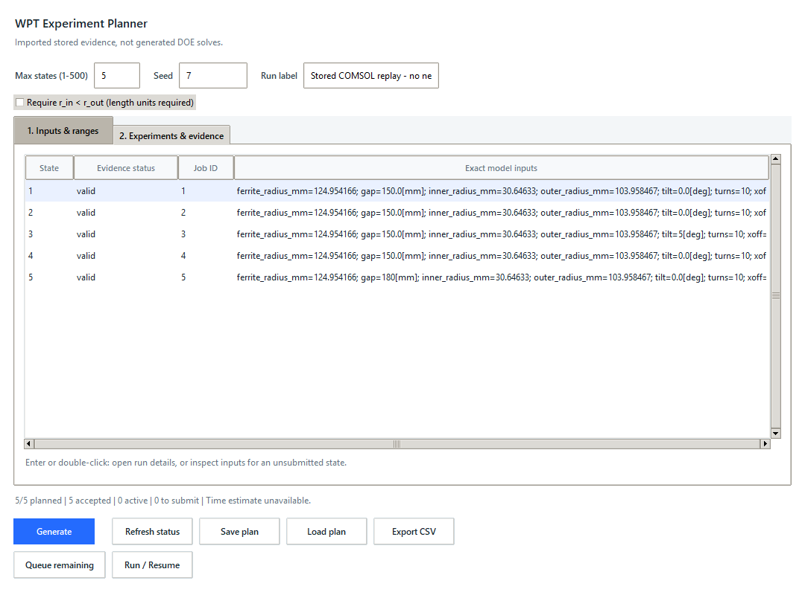

# Budgeted WPT experiment planner

## Objective and approved scope

Plan a bounded exploration of model inputs rather than expanding every grid
combination. The native desktop workflow supports continuous quantities and
integer counts, a reproducible seed, saved exact points, evidence-aware reuse,
and explicit queue/run confirmation. It is an exploration tool, not an optimizer
or a claim that an unsampled design is optimal.

## Contract and architecture

- `experiments.py`: typed ranges/specification, bounded stratified sampling,
  unique parameter sets, contract checks and campaign classification.
- `experiment_files.py`: versioned JSON with exact points and integrity digest;
  bounded loading and literal CSV evidence export.
- `experiment_ui.py`: native range editor, preview, save/load and guarded resume.
- Existing `CampaignPlan`, signatures, JobStore and sequential runner remain
  authoritative for job state. No database migration or runtime dependency.

Budget is the maximum number of unique planned states (1 to 500), including
reused states, not a license/runtime or lifetime-retry budget. Seed is a
nonnegative integer. Generate continuous values using shuffled equal-width
strata. Discretize integer inputs, deduplicate and reject invalid radius pairs.
Repeat bounded attempts to fill the budget; expose any shortfall explicitly.
Small fully discrete spaces are sampled without replacement. Rejection and
integer conversion do not retain a strict Latin-hypercube design.

All inputs must be finite scalar quantities with supported compatible units.
Counts `N1` and `N2` must use integer ranges. Preserve fixed input spelling.
When enabled, check `r_in < r_out` in common units. Contract-declared min/max,
required inputs and protected inputs are checked before generation/queuing.
Execution requires the same current model/contract/formula/target identity,
accepted connection contract, and Fresh COMSOL Job Sequence pipeline.
Saved points may be reviewed offline; no loaded JSON can start a solve.

## Style and boundaries

Use frozen dataclasses, snake_case, ValueError for invalid input and standard
library only, for example `InputRange("gap", "100[mm]", "200[mm]")`.
Always bound input sizes and attempts, clear stale previews on edits, and
rebuild status from current jobs before submission/export. Never change source
MPH files or enqueue/solve on opening, generating, loading or saving. Ask before
new dependencies/schema changes or remote publication.

## Acceptance and verification

- Stable unique points for the same spec/seed; correct units/integer bounds.
- Invalid, inverted, nonfinite, protected or incompatible ranges rejected.
- Discrete exhaustion and constrained shortfall reported, never hidden.
- Save/load preserves exact points/signatures; malformed/tampered files fail.
- Accepted and active matching states reused; failed/rejected/unvalidated
  states retryable; changed identity blocks execution.
- Native dialog handles edit invalidation, keyboard detail access, restart,
  queue-only, pause/resume, and exports without production queue changes.

```powershell
.\.venv\Scripts\python.exe -m unittest discover -s tests -p "test_experiment*.py"
.\.venv\Scripts\python.exe -m unittest discover -s tests
.\.venv\Scripts\python.exe -m compileall -q src tests examples
.\.venv\Scripts\python.exe -m pip wheel . --no-deps --no-build-isolation --wheel-dir dist
sim-assistant desktop
```

Build order: verified generator, persistence/status integration, native workflow,
then isolated examples, screenshots and final regression review. Tests use
temporary databases, not original models. Stored replay must be labeled as
stored evidence, not new COMSOL solves or hardware measurements.

## Desktop walkthrough

1. Start `sim-assistant desktop`, select the model contract and Job Sequence,
   and use **Check connection**. Only exposed contract inputs are editable.
2. In **Runs**, open **Experiment planner**, then **Import current model inputs**.
   This takes a copy of the current editor; it does not alter that editor or MPH.
3. Leave unrelated inputs **Fixed**. Choose **Continuous** for lengths such as
   `gap`/`r_out`, and **Integer** for counts `N1`/`N2`. Fill minimum and maximum
   with explicit compatible units, e.g. `100[mm]` and `20[cm]`. Fixed mode ignores
   the maximum field. Expressions such as `2*r_in` are not sampling bounds.
4. Set **Max states** and **Seed**. For a first exploration, a budget of 30 is
   an example, not a guarantee of sufficient scientific coverage. Enable the
   radius rule only when the model actually has `r_in` and `r_out` length inputs.
5. Click **Generate**. Review every point in **Experiments & evidence**, including
   shortfall, accepted, active and pending counts. A time estimate is approximate
   and uses recent successful matching-identity COMSOL jobs when available.
6. Click **Save plan** to retain exact values and execution identity. After
   restarting, use **Load plan** and **Refresh status**. Offline review does not
   need COMSOL. Editing a sampling field clears the old plan; regenerate before
   saving or submitting. Run-label changes do not change simulation identity.
7. **Queue remaining** adds only missing/retryable states; it never starts a
   solver. **Run / Resume** also processes matching queued states sequentially.
   Both require confirmation, the same model/contract/target/plots/formulas,
   and a Fresh result pipeline. Resume the global queue first if it is paused.
8. Select a row and press Enter to inspect saved Job details, or see the exact
   inputs for a missing state. **Export CSV** writes every planned state, its
   signature, inputs, available metrics, plan-origin label and evidence status. Use the existing
   Sweep workspace/Compare/Rank tools for newly completed experiment batches.

Acceptance is the existing scientific validation (`valid`/`warning`), not merely
solver completion. Failed, cancelled, rejected and unvalidated points can be
retried. Active states are not resubmitted from the current UI. Concurrent
external submitters are not coordinated by a new global scheduler.

Signatures use exact input representations: `150[mm]` and `15[cm]` are not the
same persisted intent. Reload the exact saved plan for deterministic reuse.
Generator outputs use the minimum endpoint's unit; fixed values are preserved.
Saved point hashes detect point corruption, not authenticate a sender. Inspect
imported plans and do not manually edit their identity metadata.

## Reproduce the examples without solving COMSOL

```powershell
.\.venv\Scripts\python.exe examples/replay_experiment_planner.py --desktop
.\.venv\Scripts\python.exe examples/check_experiment_planner_ui.py
```

The replay creates `.sim-assistant/experiment-example` locally. **Load plan** can
open `unsolved-doe.json` (30 generated points with no physical results) or
`stored-evidence.json` (five previously published three-dimensional COMSOL WPT
two-port cases, with scalar input text normalized for replay). Stored cases keep
their source hashes/checks and are explicitly tagged `stored-points-v1`; they
were not generated by this DOE or solved again. No new result from the original
two-dimensional wireless charger model is claimed. Both example identities are
offline-only and cannot execute against a connected model; generate a new plan
with that model's validated contract to run your own experiments.





These are captures of the actual native interface. The optional check-script
`--capture-dir` uses Pillow on Windows; Pillow is not an application dependency.
The ordinary check command requires only Tkinter and uses an isolated database.

## Limitations

This samples inputs; it does not optimize automatically, infer sensitivity,
train a surrogate, retune frequency/load, or qualify hardware safety. Budget
limits the plan size, not total solver attempts over repeated failed retries.
The sampler makes at most 20,000 candidate attempts and may return a shortfall
for tight constraints or small discrete spaces. It does not promise a strict
Latin-hypercube design after rounding, filtering or retrying. All candidates
still need model-specific geometry/mesh/physics validation after solving.
Only the explicit radius rule is a cross-input geometry check; other model
relations remain the user's responsibility. Missing output, convergence or
reference evidence must not be interpreted as a passed design.
