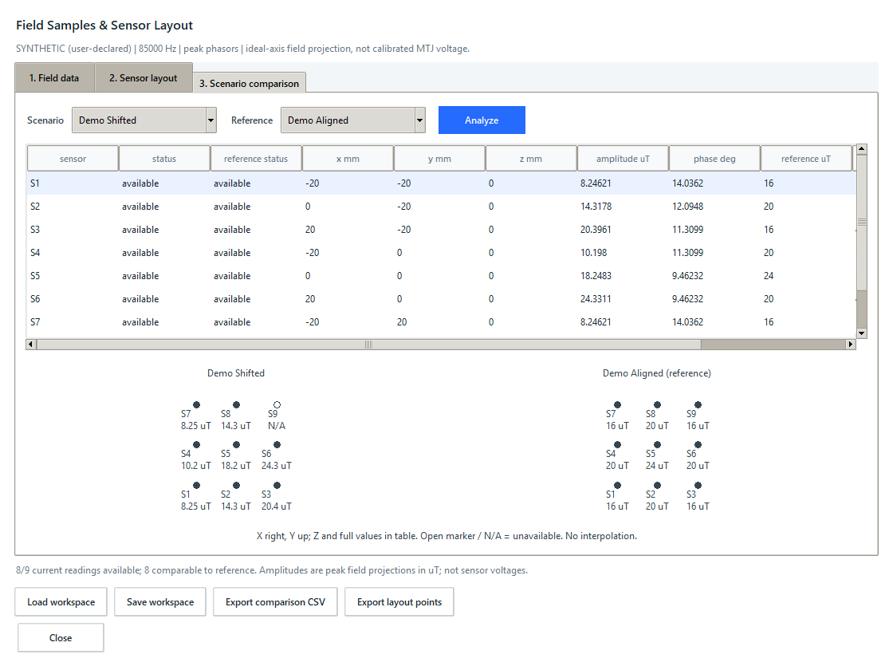
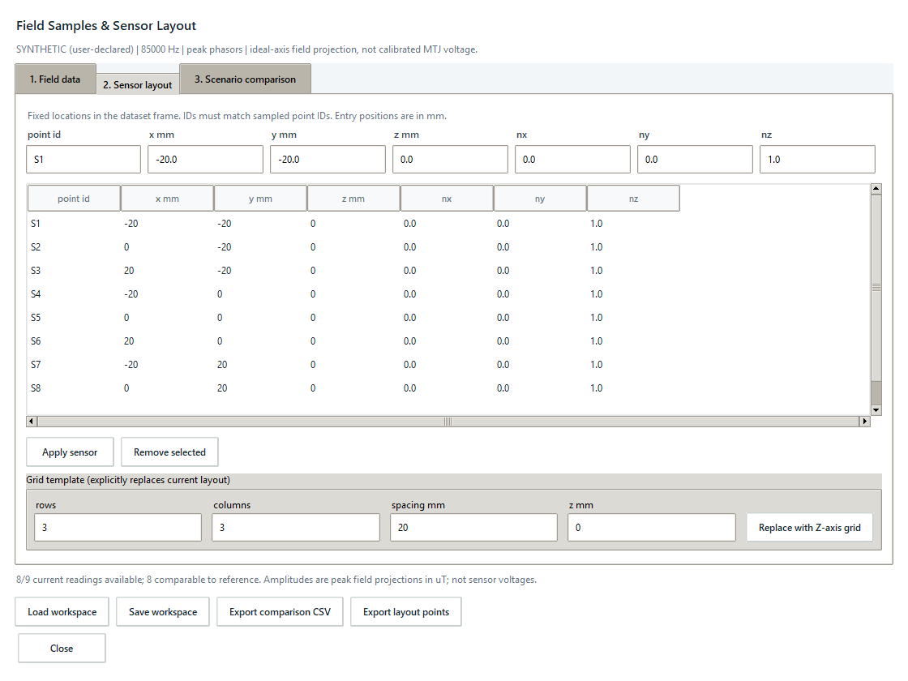

# Field Samples & Sensor Layout

## Approved objective and scope

Review imported magnetic-field phasors at fixed sensor locations, compare named
static scenarios, and retain a portable offline workspace. This is preparation
for an alignment study, not MTJ calibration, vehicle detection, DOA estimation,
dynamic simulation, a safety certificate or hardware control. No COMSOL solve,
MPH modification, queue mutation, new dependency or database migration.

## Data contract and design decisions

CSV uses exactly these columns (order may differ):
`scenario,point_id,x,y,z,bx_real,bx_imag,by_real,by_imag,bz_real,bz_imag`.
Each row is one sampled complex field at one point in one scenario. All rows
belong to the same declared frame, frequency, excitation and phasor convention.
No implicit imaginary-zero conversion, interpolation, extrapolation or RMS/peak
conversion. Normalize exports to this schema; arbitrary COMSOL CSV is not guessed.

Import metadata must explicitly declare a name, source kind (`comsol-export` or
`synthetic`), model revision, solution/dataset identifier, coordinate frame,
coordinate unit (`m`, `cm`, `mm`), field unit (`T`, `mT`, `uT`), positive frequency
in Hz, `peak` or `rms` convention, excitation description and phase reference.
Metadata is user-declared, not authenticated or automatic scientific acceptance.
Retain the input CSV SHA-256; store normalized coordinates in m and fields in T.
The importer never follows paths from file contents or fetches external URLs.

A layout has at most 256 unique sensors. Sensor ID matches the CSV point ID.
Positions and unit direction vectors use the declared dataset coordinate frame.
Compare only the matching point ID with position agreement within 1e-9 m;
missing points and changed positions remain explicit unavailable readings.
Projection is `b = nx*Bx + ny*By + nz*Bz`, with amplitude `abs(b)` and phase
`atan2(imag, real)`. Zero amplitude has undefined phase. Compare amplitude change
and wrapped phase difference against a user-selected reference scenario. A
missing reference never becomes a zero reference. No field-to-sensor-voltage
transfer function or instantaneous vector peak-field claim is inferred.

Standalone versioned JSON preserves metadata, normalized samples, layout and
source digest; bounded validation occurs again on loading. Saving is atomic.
CSV reports include all layout sensors, status, projection and reference values,
SI units, conventions and provenance. No absolute local path is exported.

## Architecture and style

- `field_samples.py`: frozen dataclasses, validation and pure projections.
- `field_sample_files.py`: bounded CSV/JSON and literal result export.
- `field_sample_ui.py`: native dialog; only a lazy entry point in desktop.py.
- `field_sample_views.py`: focused layout editor and sampled XY plot.
- Tests in `tests/test_field_sample*.py`; isolated example under `examples/`.

Use standard-library dataclasses, snake_case and ValueError at invalid-input
boundaries, e.g. `Sensor("S1", (0.0, 0.0, 0.0), (0.0, 0.0, 1.0))`.
Import caps: 5 MB CSV, 10,000 rows, 100 scenarios, 256 points per scenario;
saved JSON capped at 8 MB. Text and numbers are bounded and finite. Reject
duplicates, extra/missing columns, malformed documents and unsupported units.
All project text and interface labels remain English.

## UI acceptance

Open from native Runs, independent of any COMSOL connection. Three tabs separate
data/import metadata, sensor editing, and scenario comparison. Use existing
styles, explicit empty/error states, keyboard controls and scrollable tables.
Dataset metadata edits invalidate the imported dataset until re-import; sensor
or scenario edits clear stale comparisons. Import/load is all-or-nothing.
Show a sampled XY layout with sensor IDs and numeric readings; never imply a
continuous interpolated field. Mark synthetic data visibly in view and export.
Grid layout and import-point presets are explicit actions, not implicit results.

## Verification and boundaries

Build/test slices: validated numeric projection, import/persistence/export,
native workflow, then example/docs and regression review. Test missing/changed
points, negative/complex/zero projection, reversed axes, phase wrapping, unit
normalization, malformed/oversized files, exact restart and stale-view clearing.
Use temporary workspaces and honest synthetic examples; do not relabel existing
scalar WPT records as spatial field samples. Always test before publication;
ask before new dependencies, schema changes or remote publication.

```powershell
.\.venv\Scripts\python.exe -m unittest discover -s tests -p "test_field_sample*.py"
.\.venv\Scripts\python.exe -m unittest discover -s tests
.\.venv\Scripts\python.exe -m compileall -q src tests examples
.\.venv\Scripts\python.exe -m pip wheel . --no-deps --no-build-isolation --wheel-dir dist
sim-assistant desktop
```

## Desktop walkthrough

1. Open **Runs > Field samples**; no COMSOL connection is needed for this offline
   workspace. Enter every metadata field in **Field data**. Labels accept 1-80
   ASCII letters/numbers, spaces, underscores, dots and hyphens, not local paths.
   Source `comsol-export` is a declaration, not proof of source authenticity.
2. Choose **Import CSV**. A scalar-results CSV containing L/M/k is not spatial
   evidence; a Plot PNG is not a numeric vector-field export. Supply real and
   imaginary parts of each Cartesian component at the sampled locations. A
   missing component is an error, not an assumed zero. Known real fields still
   need explicit zero imaginary columns. Source phasors must share a phase
   reference; differences are not meaningful across unrelated phase references.
3. In **Scenario comparison**, select the scenario whose locations you want as
   a fixed layout. In **Field data**, choose **Use scenario points as sensors**.
   This copies positions and gives each sensor a +Z axis; review it before use.
4. In **Sensor layout**, select a row (Enter is supported), edit ID/position and
   direction components, then **Apply sensor**. Positions are entered in mm.
   Directions are normalized, so `(0,0,2)` means the same direction as `(0,0,1)`.
   A negative direction reverses phasor sign, not amplitude. Applying an existing
   ID updates it; entering a new ID adds a sensor. Remove the old row explicitly
   if renaming. Unapplied edits block analysis/save/export rather than silently
   using the old sensor. Reselecting a stored row discards the unapplied entry.
5. Alternatively, **Replace with Z-axis grid** explicitly replaces the layout
   with S1, S2, ... in row-major order, centered around X=Y=0. Change spacing and
   Z in mm. This generates locations only, not field values. Export those points
   to use as sampling locations in a separate COMSOL export workflow.
6. Choose current/reference scenarios and **Analyze** (Ctrl+R). The table gives
   amplitude in uT using the declared peak/RMS convention, phase in degrees,
   reference amplitude, signed amplitude change and wrapped phase difference.
   Scroll horizontally for all columns. Zero amplitude has no defined phase;
   that phase cell is unavailable, not zero. Enter/double-click gives numeric
   complex projections, metadata and the source digest.
7. The XY views show sampled markers only: X right and Y up. Filled markers have
   a reading; open markers are unavailable. Small layouts show numeric labels
   when space permits; the table is authoritative. Different Z locations can
   overlap in XY; inspect Z in the table. No continuous field map is inferred.
8. **Save workspace** retains exact normalized samples, layout and metadata.
   **Load workspace** revalidates them independently of the original CSV, and
   defaults to the first scenario as reference and last as current. It does not
   retain a transient comparison selection. Hashes detect accidental corruption,
   not authenticate a sender or certify COMSOL acceptance. Inspect imported data.
9. **Export comparison CSV** exports every sensor, including unavailable states,
   normalized direction, real/imaginary current/reference projection, phase,
   source declaration and CSV digest. Results use SI columns ending in `_m` and
   `_t`; `import_*_unit` records only the original CSV units. **Export layout
   points** writes coordinates in m and unit directions, without field results.

Each new CSV import clears the old layout to avoid reusing locations from a
different coordinate frame. Copy sample locations again or explicitly rebuild
the layout. A saved workspace reloads its own exact fields and layout together.
Changing dataset metadata clears imported data and requires a fresh import; it
cannot relabel already-normalized fields. Changing sensor entries or scenario
selection clears stale results. Failed import/load accepts no partial dataset.
No action in this dialog changes production jobs or model files. All labels
remain user-declared research evidence, not component qualification or safety.

## Reproduce the synthetic example

```powershell
.\.venv\Scripts\python.exe examples/check_field_samples_ui.py
.\.venv\Scripts\python.exe examples/check_field_samples_ui.py --desktop
```

The demonstration uses `examples/synthetic_field_samples.csv` and the companion
`synthetic_field_metadata.json`. Values were hand-defined to exercise phase,
layout and incomplete data handling, not simulated from a WPT model. A centered
3x3 layout has nine reference samples but only eight shifted samples: S9 remains
explicitly missing. The 85 kHz label is illustrative, not a sensor bandwidth
specification. The script uses a temporary isolated database, verifies CSV and
native layouts/keyboard handling, and starts no solver. With `--desktop`, export
anything you want to keep before closing; its temporary demo is then removed.
Generated application screenshots below show that exact synthetic example.





The optional Windows `--capture-dir` check needs Pillow; the application and
ordinary native check do not. No additional runtime dependencies are required.

## Research limits and next increment

A single-axis projection models the component of B along an ideal direction.
It does not account for MTJ sensitivity, bias, saturation, frequency response,
noise or calibration. A component phasor magnitude is not an instantaneous
three-dimensional vector maximum when components have different phases.
The field source (TX, RX or combined operating excitation) must be explicit;
one-ampere characterization fields are not automatically loaded operating fields.
The feature does not estimate a moving vehicle's position, decide WPT selectivity
or implement a dynamic controller. Future direct COMSOL extraction must identify
the exact saved solution and sample locations without modifying original models.
