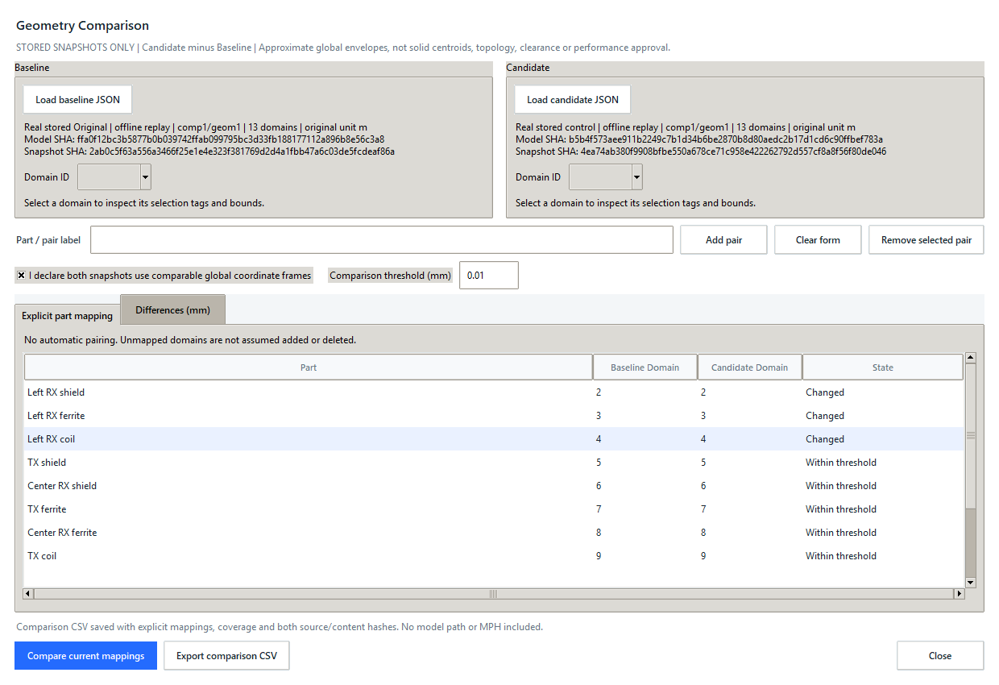
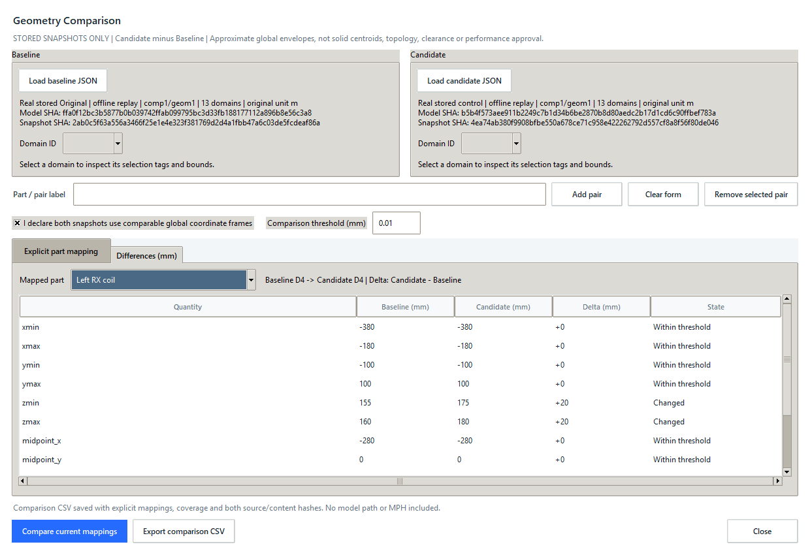

# Geometry Comparison

## Using the desktop workspace

1. Run `sim-assistant desktop`, open **Runs > Geometry inspector**, then select
   **Compare snapshots**. An existing inspector snapshot prefills only Baseline;
   no pairs or frame declaration are filled automatically.
2. Select **Load baseline JSON** and **Load candidate JSON**. These are saved
   geometry snapshots, not MPH files or live connections. To create a snapshot,
   inspect saved geometry and use **Save snapshot** in the inspector first.
3. On each side choose a Domain ID. Read the displayed selection tags and six
   bounds in mm. Enter a meaningful English part/pair label, such as `Left RX
   coil`, then **Add pair**. Every pair must be explicitly chosen; a matching ID
   is not proof that two parts correspond. One domain cannot serve two pairs.
4. Repeat for the parts you want to compare. **Clear form** discards an unapplied
   pair; **Remove selected pair** removes an applied mapping. Unapplied fields
   must be added or cleared before comparison/export.
5. Declare comparable global coordinate frames only after checking the source
   models' axes, origins and orientation. SI unit conversion has already happened
   when snapshots were read; it does not align different coordinate systems.
6. Set the absolute comparison threshold in mm (default 0.01), then select
   **Compare current mappings**. The mapping tab shows which pairs exceed the
   threshold. The differences tab shows one selected pair's 12 metrics; use its
   selector or press Enter on a mapping row to switch parts. Scroll to see all
   rows. UI values use six significant digits; CSV retains full numeric values.
7. Select **Export comparison CSV**. Every row identifies its pair, quantity,
   signed change, threshold and both sources. Export schema is
   `wpt.geometry-comparison.v1`. Unmapped IDs and counts remain explicit; CSV
   coverage does not certify that all real parts were identified correctly.

Changing a mapping, source, pending form, threshold or frame declaration clears
the accepted result. Recompare before export. Failed loads/saves preserve work;
source replacement and closing unsaved mappings ask permission. A CSV is a
report, not a reloadable mapping session. Loading snapshots is not continuous
monitoring of external model or JSON edits. Checksums are not authentication.
Export needed reports before quitting the main application; this workspace
does not provide automatic session recovery.
Automatic source file paths and MPH data are not added to CSV. User-entered
labels and selection tags can still contain confidential text; review them
before sharing a report or screenshot.

### Python interface

```python
from simulation_assistant.geometry_files import load_snapshot
from simulation_assistant.geometry_comparison import DomainPair, compare_geometry
from simulation_assistant.geometry_comparison_files import export_comparison_csv

baseline = load_snapshot('examples/saved_geometry_wpt/original.json')
candidate = load_snapshot('examples/saved_geometry_wpt/overlap.json')
# Explicit correspondence and comparable frames verified for these two fixtures.
comparison = compare_geometry(baseline, candidate,
    (DomainPair('Left RX coil envelope', 4, 4),), comparable_frames=True,
    tolerance_mm=0.01)
export_comparison_csv('geometry-comparison.csv', comparison)
```

## Worked real-snapshot example

The existing [stored WPT snapshots](../examples/saved_geometry_wpt/README.md)
include Original, Overlap and Height-matched control. This example declares
correspondence for 12 known solid-domain envelopes and leaves air (D1) unmapped.
IDs and roles are specific to these exact source hashes, not a general matching
algorithm. No model is opened, modified or solved during replay.

```powershell
python examples/replay_geometry_comparison.py --headless
python examples/replay_geometry_comparison.py --candidate control --headless
python examples/replay_geometry_comparison.py --desktop
python examples/replay_geometry_comparison.py --candidate control --desktop
python examples/replay_geometry_comparison.py --headless --output-dir artifacts/comparison-export
```

The output folder option retains a 144-row CSV; omit it for a disposable check.
The script refuses an existing report overwrite. Optional `--capture-dir`
captures the real native window on Windows if Pillow is already installed;
Pillow is not an application runtime dependency. Headless replay needs no Tk,
COMSOL or license. Native replay uses an isolated temporary queue, not your data.

| Candidate vs Original | Left RX envelope midpoint X change | Left RX envelope midpoint Z change | Changed mapped envelopes |
| --- | --- | --- | --- |
| Overlap | approximately +140 mm | approximately +20 mm | 6 of 12 |
| Height-matched control | approximately 0 mm | approximately +20 mm | 6 of 12 |

The right RX X change is approximately -140 mm in Overlap. Spans remain within
the default comparison threshold. These are envelope differences; they do not
establish which charging design performs better.

Actual, unretouched native-window captures of the real stored snapshots:






## Objective and approved scope

Compare two stored geometry snapshots as Baseline and Candidate without COMSOL,
model edits, builds or solves. Users explicitly map corresponding domains to a
named part. IDs, equal names and matching selection tags never establish part
identity automatically. This extends the saved-geometry workspace, not the
sensor-response, electrical-performance or clearance workflow.

## Contract

- Reuse the strict `wpt.geometry-snapshot.v1` loader; at most 256 domains per side.
- Require an explicit declaration of comparable global coordinate frames. No
  registration, rotation, rescaling or inferred coordinate transformation.
- Accept 1-256 one-to-one mappings. Each has a unique printable English label
  (1-80 characters) and an existing integer domain ID on each side. Boolean IDs,
  duplicate labels ignoring case, and reuse of a domain on either side fail.
- Compare all six global bounds, three envelope midpoints and three envelope
  spans in mm. Delta = Candidate minus Baseline. Envelope midpoints are not
  mass/solid centroids; spans are not verified part dimensions or layer thickness.
- A user-set absolute comparison threshold (default 0.01 mm, range 0-1000 mm)
  labels a metric changed only when `abs(delta) > threshold`. It is not a
  manufacturing tolerance or a statement about measurement accuracy. No relative
  threshold or percentage near zero. A changed pair has any changed metric.
- Always report unmapped IDs separately; they are not assumed added/deleted.
  No statement about whole-model equivalence, topology, holes, intersection,
  power or safety follows from matching envelopes, even with complete mapping.
- Source MPH SHA-256 and canonical snapshot content SHA-256 identify each side.
  Snapshot hashes are consistency records, not authentication or signatures.
- CSV includes explicit mappings, every metric, signed deltas, threshold, frame
  declaration, coverage and source evidence. Escape spreadsheet text, write
  atomically, reject stale/modified results and protect existing files on errors.

## Native workflow and design contract

Use existing Python >=3.10, Tk/ttk styles and standard-library persistence, with
no new dependencies or schema changes. A Geometry inspector action opens a
separate comparison window. Load Baseline/Candidate JSON, inspect selected
domain tags/bounds, add labeled pairs, declare comparable frames and compare.
Show pair summaries and one selected pair's 12 metrics with numeric values and
textual states (never color alone). Keep keyboard navigation, scrollbars,
empty/error/success states and 1000x760 / 1240x850 window checks.

A successful source replacement clears mappings, frame declaration and results
after discard permission. A failed load preserves current work. Pair, threshold
or frame edits invalidate output; unapplied pair fields block comparison/export.
Closing unsaved work asks permission. A saved CSV is a report, not a reloadable
mapping session. No external-file monitoring is implied by loading a snapshot.

## Implementation and verification

1. `geometry_comparison.py` and logic tests: typed frozen input/output, explicit
   identity/frames, signed metrics, threshold and unmatched coverage.
2. `geometry_comparison_files.py` and file tests: source/content identity, guarded
   CSV and atomic failure protection; reuse existing snapshot persistence.
3. `geometry_comparison_ui.py`, focused widgets and native tests: complete
   isolated load/map/compare/export flow, stale/pending/discard protections.
4. Real stored original/overlap/control replay, actual captures, documentation
   and full regression/build verification. No original MPH is publication input.

```powershell
.\.venv\Scripts\python.exe -X utf8 -m unittest discover -s tests -p "test_geometry_comparison*.py" -v
.\.venv\Scripts\python.exe -X utf8 -m unittest discover -s tests
.\.venv\Scripts\python.exe -X utf8 -m compileall -q src tests examples
.\.venv\Scripts\python.exe -X utf8 -m pip wheel . --no-deps --no-build-isolation --wheel-dir dist
```

Always validate external files and user mappings and preserve research models.
Ask before dependencies, schema changes, live solves or remote publication.
Never lower test assertions, infer part identity or turn approximate bounds
into an electrical/engineering approval. Keep this increment ready for review;
commit/push only on explicit finalization.

## Runtime references

- [ttk Treeview / Notebook](https://docs.python.org/3.12/library/tkinter.ttk.html)
- [CSV writer and newline handling](https://docs.python.org/3.12/library/csv.html)
