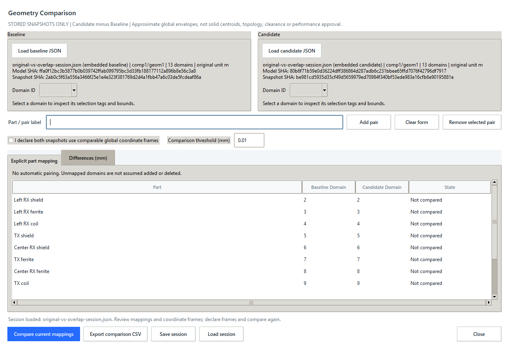
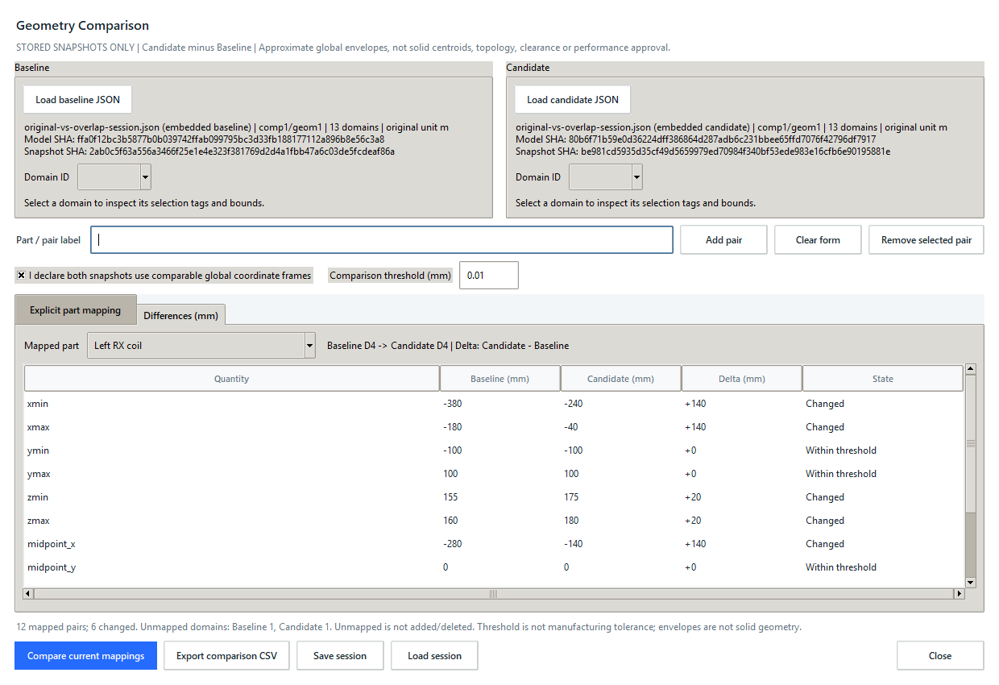

# Geometry Comparison Sessions

## Objective and scope

Save and reopen a manual geometry comparison without reloading separate snapshot
files or rebuilding explicit part mappings. A session is a portable input draft,
not a trusted result or an automatic crash-recovery checkpoint. It never opens,
changes or solves an MPH model. The existing snapshot and CSV formats remain
compatible. No new dependency or database schema is required.

## Quick start

Run `sim-assistant desktop`, open **Runs > Geometry inspector > Compare
snapshots**, load Baseline/Candidate JSON and add the explicit pairs. Choose
**Save session** and use a separate name such as `comparison-session.json`.
You can close that comparison window and use **Load session** in a new one.
Review the restored mappings, confirm comparable coordinate frames again and
choose **Compare current mappings**. A `*` in the window title means inputs
are not retained in the last saved/loaded session. Saving a CSV does not remove
that indicator. Pending form text must be added as a pair or explicitly cleared.

The format embeds snapshots; you do not need the original JSON files or COMSOL
to reopen it. It does not check whether the original model changed after the
snapshot was taken. Save manually before exiting the main app; there is no
automatic crash recovery. Keep CSV reports separately if you need a record of
the comparison result and the declaration made for it.

## Contract

The `wpt.geometry-comparison-session.v1` JSON has exactly `schema`, `baseline`,
`candidate`, `pairs`, `tolerance_mm` and `session_sha256`. Both snapshots are
embedded complete `wpt.geometry-snapshot.v1` documents with their own checksums.
Each pair has exactly `label`, `baseline_domain` and `candidate_domain`.
Zero to 256 one-to-one mappings are allowed so an unfinished draft can be saved.
Comparing still requires at least one mapping and an explicit comparable-frame
declaration. Thresholds are finite numbers in the existing 0-1000 mm range.

The outer SHA-256 covers the canonical sorted compact JSON without its checksum
field, including both embedded checksums. Hashes detect inconsistency, not
authenticity or scientific correctness. No file paths, cached differences,
frame approval, credentials, MPH contents or solver state are stored. Labels
and selection tags may contain private text: review them before sharing.

Reject duplicate JSON fields at any depth, unknown fields, invalid nested
snapshots, broken hashes, non-finite numbers, booleans used as numbers, invalid
or repeated mappings and files above 2,100,000 bytes. Save validates before
writing and atomically replaces only the selected `.json` target. The native
dialog refuses to overwrite either separately loaded source snapshot.

## Native workflow and acceptance criteria

1. In Geometry Comparison, load both snapshots and add explicit part pairs.
   Add or clear pending form fields, then choose **Save session**. Saving does
   not require frame approval or a computed result and does not invalidate an
   already computed result. Two loaded snapshots with no pairs can be saved.
2. Choose **Load session**. Parse and validate the entire document before
   replacing anything; confirm discarding any unsaved inputs. Failed or
   cancelled operations preserve current work. A valid load restores sources,
   mappings and threshold together, clears the form, unchecks frame approval,
   clears all results and opens the mapping tab.
3. Review the coordinate frames, check the declaration, and choose **Compare
   current mappings**. CSV is a result report, not a reloadable session. CSV
   export does not clear the unsaved-session indicator. Frame approval and
   recomputation alone do not mark saved session inputs as changed.
4. Closing with unsaved inputs asks before discarding them. No application-wide
   recovery, automatic saving, automatic pairing or scientific approval exists.

## Structure, style and verification

Python 3.10+, standard library only. Session codec lives in
`src/simulation_assistant/geometry_comparison_sessions.py`; native lifecycle
uses the existing comparison controller and widgets. Frozen dataclasses and
`ValueError` validation follow the neighboring geometry modules, for example:

```python
session = GeometryComparisonSession(baseline, candidate, pairs, tolerance_mm=.01)
save_session("comparison-session.json", session)
restored = load_session("comparison-session.json")
```

Tests belong in `tests/`, using unittest with real snapshot fixtures, temporary
files, native Tk windows and mocked file choosers only at OS-interaction seams.
Verify roundtrips, tampering, resource bounds, atomic-write failure, dirty-state
and stale-result protection, keyboard access and minimum/normal window layouts.

```powershell
.\.venv\Scripts\python.exe -X utf8 -m unittest discover -s tests -v
.\.venv\Scripts\python.exe -X utf8 -m compileall -q src tests examples
.\.venv\Scripts\python.exe -m pip wheel --no-deps --no-build-isolation . -w dist
.\.venv\Scripts\python.exe -X utf8 -m simulation_assistant desktop
```

Always preserve source models, validation gates and English repository content.
Ask before adding dependencies, changing schemas or publishing. Never commit
secrets, trust imported approval, silently discard pending work or run COMSOL
for this feature. No open requirement questions remain for this increment.

## Worked real-snapshot roundtrip

Use the [existing Original/Overlap/Control snapshots](../examples/saved_geometry_wpt/README.md).
These are previously measured saved-model envelopes, not new scientific solves.
The replay explicitly maps the same 12 known solid domains as the
[comparison example](GEOMETRY_COMPARISON.md); air remains unmapped. It saves
the full session, reloads it, and checks the recomputed differences against the
original comparison. Native replay additionally verifies that imported inputs
have no accepted result or frame declaration before explicit re-confirmation.

```powershell
python examples/replay_geometry_comparison.py --session-roundtrip --headless
python examples/replay_geometry_comparison.py --session-roundtrip --candidate control --headless
python examples/replay_geometry_comparison.py --session-roundtrip --desktop
python examples/replay_geometry_comparison.py --session-roundtrip --headless --output-dir artifacts/session-example
```

The optional output folder retains both session JSON and result CSV and must
not already contain either output. Native checks use an isolated disposable
queue, not production data. Optional `--capture-dir` saves actual native-window
captures on Windows when Pillow is available; Pillow is not a runtime dependency.

Actual native captures of Original versus Overlap, first reopened with no frame
approval/result and then explicitly confirmed and recomputed:




