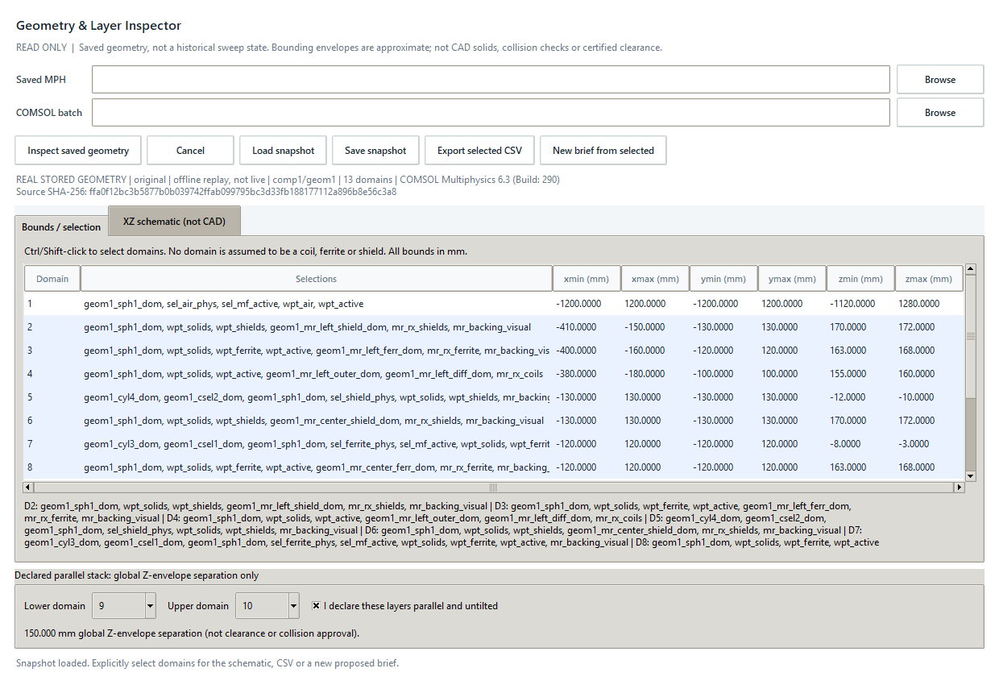
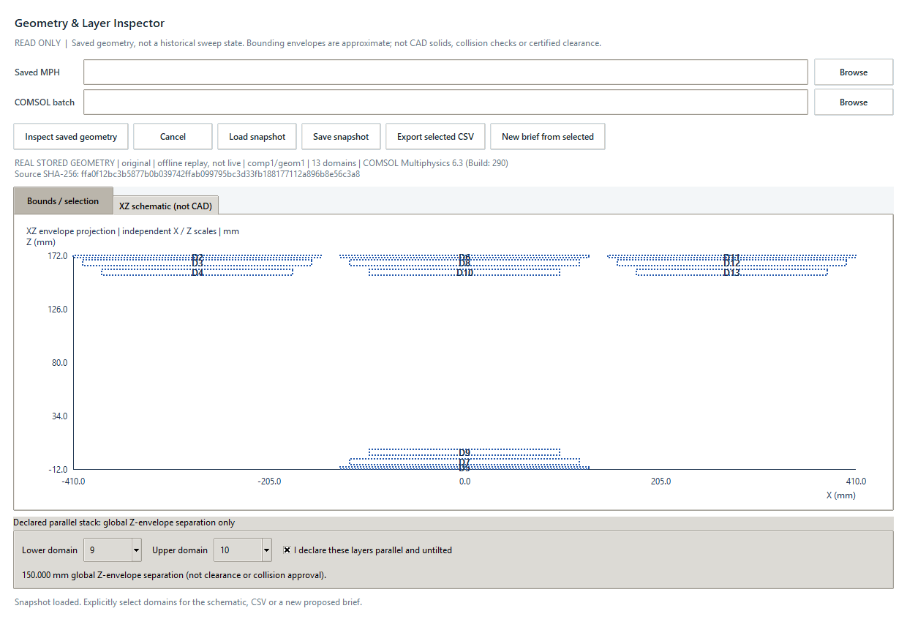
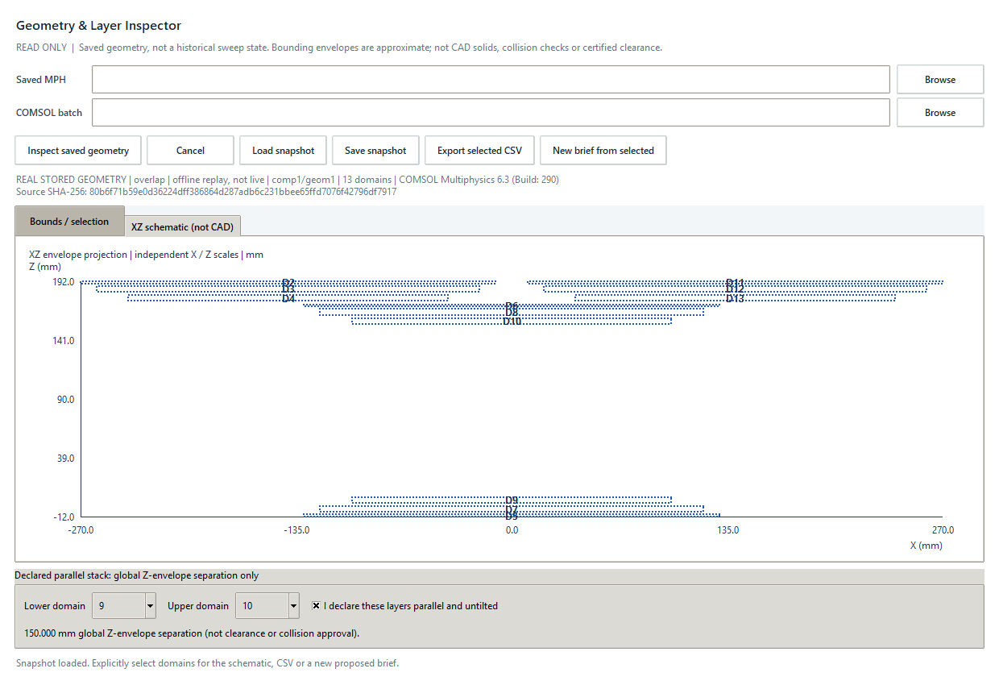
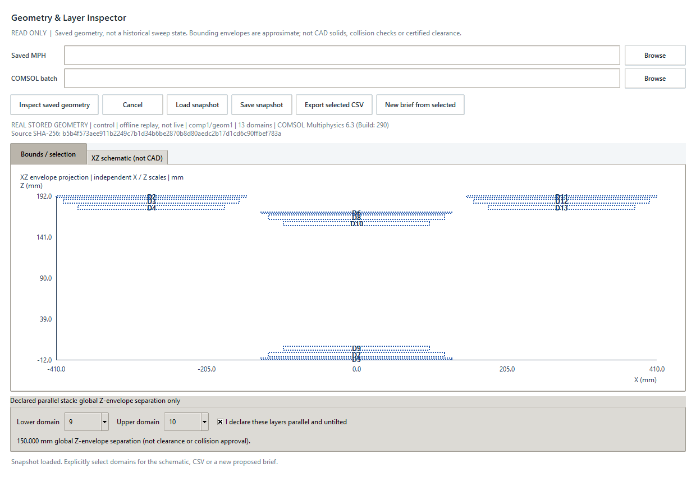

# Geometry & Layer Inspector

## Use the native inspector

This workspace answers: which saved domains are present, where are their global
bounds, and how does an explicitly selected layer stack look in XZ projection?
It does not calculate field samples, power, MTJ response or physical clearance.

1. Start the native app with `sim-assistant desktop`, then open **Runs > Geometry
   inspector**. Python/Tk is sufficient for stored-snapshot replay.
2. For a fresh inspection, browse to a saved `.mph` and `comsolbatch.exe` in the
   installed COMSOL `bin/win64` folder. `comsolcompile.exe` must be beside it.
   COMSOL 6.3 was tested. A working local installation/license is required.
3. Select **Inspect saved geometry**. The worker hashes the source, measures a
   private copy, checks the original hash again and discards changed sources.
   **Cancel** stops the owned inspection process; it does not stop another
   COMSOL session. Missing/unbuilt geometry never triggers an automatic build.
4. In **Bounds / selection**, inspect domain IDs, selection tags and six global
   bounds in mm. Use Ctrl/Shift-click to select domains. Identify their roles
   from your model, not their numeric IDs. Include/exclude air explicitly.
5. Open **XZ schematic (not CAD)**. Dashed rectangles are bounding envelopes;
   they include holes and may overlap even when solids do not. X and Z use
   independent fitted scales. The table/CSV, not apparent slope, gives values.
6. Optionally choose distinct lower/upper domains and explicitly declare an
   untilted parallel stack. A Z-envelope separation is available only when the
   chosen global envelopes are ordered in Z and overlap in XY. Otherwise the
   answer is **Unavailable**. This is never a minimum-distance/collision check.
7. **Save snapshot** saves all domains to bounded JSON, including source and
   content SHA-256. **Export selected CSV** saves only explicitly selected
   domains. Neither includes an absolute source path or copies MPH data.
8. **New brief from selected** opens a separate unsaved Model Brief with six
   proposed bounds per selected domain (at most 16 domains). Review its source,
   name and revision, then save JSON. No existing brief is merged or overwritten.

Editing either source input clears the accepted snapshot and pending results.
Snapshots remain evidence of the inspected saved file, not continuous monitoring
of later external file edits. Reinspect after changing a model in COMSOL.
Stored snapshot checksums detect accidental corruption, not hostile replacement
or source authenticity. Only load trusted MPH files/executables, and review
even path-free selection names/bounds for confidential design details.

## Worked saved-model example

The [portable real-model fixtures](../examples/saved_geometry_wpt/README.md)
contain envelopes from Original, Overlap and Height-matched control models.
The MPH files are not published. Replay them without COMSOL:

```powershell
python examples/replay_saved_geometry.py --desktop
python examples/replay_saved_geometry.py --snapshot examples/saved_geometry_wpt/overlap.json --desktop
```

These are actual native-window captures showing **real stored geometry, offline
replay**, not a new simulation or live connection. The example explicitly maps
verified domain IDs and declares the center TX/RX pair parallel; normal app
usage requires your own selection and declaration. All three center pairs give
about 150 mm global Z-envelope separation, not certified clearance.









Do not visually compare distances between differently fitted screenshot axes.
Use the underlying JSON/CSV bounds; each panel labels its own scales.

## Approved objective and boundaries

Read saved finalized Cartesian 3D geometry from a private MPH copy, show domain
axis-aligned bounds in global coordinates, and draw an explicitly schematic XZ
envelope view. No geometry build, mesh, solve, parameter change or source save.
This is geometry evidence, not operating-point, collision or safety validation.

## Contract and implementation order

1. A shared bounded read-only compiler/batch transport preserves field sampling
   behavior. `SavedGeometryInspector.java` reads a single 3D geometry, per-domain
   bounds and explicit named selection tags. It never infers part roles from IDs.
2. `geometry_inspector.py` validates finite SI envelopes, source identity and
   exact protocol/schema. `geometry_files.py` stores bounded path-free snapshots,
   CSV and proposed Model Brief drafts with explicit source references.
3. A native editor uses existing ttk styles, background inspection, cancellation
   and edit-generation guards. Users explicitly select domains and lower/upper
   envelopes. Source edits invalidate results and disable exports.
4. Actual stored original/overlap/control model checks, portable replay fixtures,
   labeled native captures and complete regressions precede publication.

The only distance quantity is a nonnegative global Z-envelope separation for
ordered envelopes with overlapping XY bounds, after a user declaration of an
untilted parallel stack. Otherwise it is unavailable, never zero substituted.
XY bounds overlap is not proof of intersecting surfaces; ring holes, rotations,
tilt and shape detail are absent. Even a declared parallel case is not certified
minimum 3D clearance. Render all charts as bounding envelopes, not solid coils.

Snapshot schema `wpt.geometry-snapshot.v1`: source SHA-256, component/geometry
tags, original geometry unit, engine version and at most 256 unique domain rows
with selection names and six finite SI bounding coordinates. No absolute paths,
model author details or MPH data. Size cap 1 MB, strict fields/duplicate-key
rejection. Snapshots describe current saved geometry, not a selected solution's
historical sweep position. Do not pair them with solution fields implicitly.

New brief generation is explicit, produces a new unsaved draft, retains the
model digest and marks entries `proposed`, never `confirmed`. It does not mutate
or merge an existing brief. Export at most 16 domains so all six bounds fit the
128-entry brief limit. Invalid inputs, cancelled tasks, failed/incomplete engines
and stale source files must leave no accepted result or partial snapshot.

## Stack, style and verification

Python >=3.10 standard library/Tk; COMSOL 6.3 compiler and batch installed
locally; no new runtime dependencies. Use frozen dataclasses, ValueError for
invalid data, existing process cancellation and ttk styles. Example domain:
`GeometryPart(1, "coil_tx", (-.1, .1, -.1, .1, 0., .005))`.

```powershell
.\.venv\Scripts\python.exe -m unittest discover -s tests -p "test_geometry*.py" -v
.\.venv\Scripts\python.exe -m unittest discover -s tests
.\.venv\Scripts\python.exe -m compileall -q src tests examples
.\.venv\Scripts\python.exe -m pip wheel . --no-deps --no-build-isolation --wheel-dir dist
```

Test parser shape, finite/order limits, unsupported dimensions/units, unchanged
source hashes, cancellation/failure/stale edits, strict portable round trips,
unavailable separations, explicit proposals and isolated UI keyboard/window sizes.
Always: validate untrusted engine/file inputs and preserve originals. Ask before
new solves/dependencies/schema changes. Never: publish private models, credentials
or local paths; auto-build missing geometry; relabel replay as live inspection.

## API sources

- [GeomMeasureBase](https://doc.comsol.com/6.3/doc/com.comsol.help.comsol/api/com/comsol/model/GeomMeasureBase.html)
- [GeomMeasureFinal](https://doc.comsol.com/6.3/doc/com.comsol.help.comsol/api/com/comsol/model/GeomMeasureFinal.html)
- [GeomInfo](https://doc.comsol.com/6.3/doc/com.comsol.help.comsol/api/com/comsol/model/GeomInfo.html)
