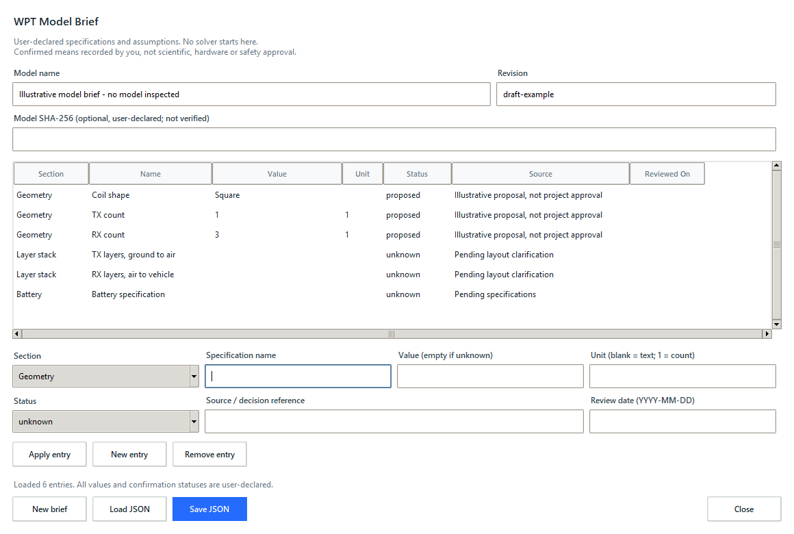

# WPT Model Brief

## Objective and scope

Record the specifications and uncertainty behind one revision of a model in an
offline native form. Users declare facts; the app does not inspect, change or
solve COMSOL models. Confirmation is a user declaration, not scientific or safety
approval. Existing contracts, queues, results and databases remain unchanged.

## Contract and decisions

Use a separate `wpt.model-brief.v1` JSON document: name, revision, optional
user-declared model SHA-256 and ordered entries. Each entry contains section,
name, value, unit, status, source and review date. Sections cover Geometry,
Layer stack, Materials, Excitation, Battery, Limits and Other. Entry names are
unique within a section (case-insensitive). Preserve order, including declared
layer order. Label a stack's direction explicitly in its name or value.

Statuses: `unknown` has an empty value; `assumed`, `proposed` and `confirmed`
require a value and source. `confirmed` also requires an ISO review date.
Dates, when supplied, must be real calendar dates in YYYY-MM-DD form. Empty
units mean descriptive text; numeric entries use a supported unit (`1` for
counts). Reuse the quantity parser; reject expressions and nonfinite numeric
values. This is format validation, not a geometry or component-rating check.

Limit input to 256 KB, 128 entries, bounded single-line ASCII text and exact
allowlisted fields. Reject duplicate keys, unsupported schema, wrong types and
oversized/deep JSON. Never execute or follow source text. Save atomically to an
explicit `.json` destination; no automatic local paths or personal data added.
User-written source text may contain private information: review before sharing.
No database migration, dependency, schema change to existing files, automatic
result association or comparison report in this increment.

## Structure and verification

Frozen `BriefEntry` / `ModelBrief` dataclasses and persistence live in
`model_briefs.py`; the native editor lives in `model_brief_ui.py`. Match existing
ttk styles, with labeled fields, table scrollbars, explicit Apply/Remove, save
and load, status feedback, and unsaved-change protection. Pending entry edits
must not be silently saved or discarded. Failed loads preserve current work.
No COMSOL connection is required. Open through **Runs > Model brief**.

```powershell
.\.venv\Scripts\python.exe -m unittest discover -s tests -p "test_model_brief*.py" -v
.\.venv\Scripts\python.exe -m unittest discover -s tests
.\.venv\Scripts\python.exe -m compileall -q src tests examples
.\.venv\Scripts\python.exe -m pip wheel . --no-deps --no-build-isolation --wheel-dir dist
```

Test empty/unknown drafts, provenance requirements, finite quantities, strict
JSON boundaries, atomic writes, exact round trips and failure preservation.
Verify native add/edit/remove, save/load, keyboard access, narrow/normal window
sizes and no queue mutation. Use explicitly labeled illustrative metadata,
not new simulation or hardware evidence.

## API references

The parser uses `object_pairs_hook` to reject duplicate keys and bounded reads
before decoding, following the [Python JSON documentation](https://docs.python.org/3.12/library/json.html).
The table uses selection events and standard scrolling from
[ttk.Treeview](https://docs.python.org/3.12/library/tkinter.ttk.html#treeview).

## Native workflow

1. Start `sim-assistant desktop`, open **Runs > Model brief**. This works offline,
   without a connected COMSOL model or queued job.
2. Enter a model name and revision. An optional model SHA-256 is a manual
   declaration, not a file lookup, verified binding or automatic result link.
3. For each specification, choose a section and enter a unique name. Use e.g.
   `Coil shape` with text `Square`, or `RX count` with value `3`, unit `1`.
   Dimensions use separate numeric values and units, e.g. `200` and `mm`.
   A blank unit means text: no physical dimension can be checked in that mode.
   Numerical mode accepts the application's supported scalar units, not formulas.
4. Choose a status. `unknown` requires an empty value; it is not a zero.
   `assumed` and `proposed` require a nonempty value and source. `confirmed`
   requires those plus a review date such as `2026-11-02`. Record a source or
   decision reference without publishing private correspondence. A date alone
   does not prove approval, authenticity or engineering validity.
5. Choose **Apply entry**. Select a table row to edit it; Enter moves focus into
   the editor. Renaming updates that row rather than adding a second entry.
   **New entry** starts another row and asks before discarding pending edits.
   **Remove entry** removes the selected applied row from this draft.
6. Give layer stacks an explicit direction, e.g. `TX layers, ground to air`.
   Enter the known order as text, or leave it unknown until clarified. The app
   preserves entry order but does not infer layer placement or draw a chassis.
7. **Save JSON** (Ctrl+S) writes only the chosen `.json` file. Pending entry
   edits must be applied or explicitly discarded first. An asterisk in the
   window title means unsaved work. There is no autosave or background upload.
8. **Load JSON**, **New brief**, closing the window and Escape protect unsaved
   work with a discard confirmation. Invalid imports preserve the current
   document. Keep separate files/revisions for separate models; this increment
   does not compare revisions, associate jobs or export comparison reports.

File limits: 256 KB, 128 entries; model name 120 characters, revision and entry
name 80, value/source 400 and unit 24. Text is single-line printable ASCII with
no leading/trailing spaces. Descriptive text and declared provenance are not
evaluated, fetched from URLs or sent to a solver. Review all free text before
sharing; the app cannot automatically redact private content you entered.

## Illustrative example and native check

Load [wpt_model_brief.json](../examples/wpt_model_brief.json) to try the form.
It contains illustrative proposed coil metadata and unresolved layers/battery.
It is not an inspected model, approved design or simulation result. Do not
treat its values as specifications for your research model.

```powershell
.\.venv\Scripts\python.exe examples/check_model_brief_ui.py
.\.venv\Scripts\python.exe examples/check_model_brief_ui.py --desktop
```

These commands use a temporary app database and check actual native editing,
JSON round trips, keyboard handling, pending-edit protection and 920x700 /
1160x780 window layouts. They do not touch production results or run COMSOL.
Optional `--capture-dir artifacts/model-brief-ui` uses Pillow on Windows;
ordinary checks and the application do not need Pillow.

Actual application capture with illustrative metadata, not simulation evidence:


