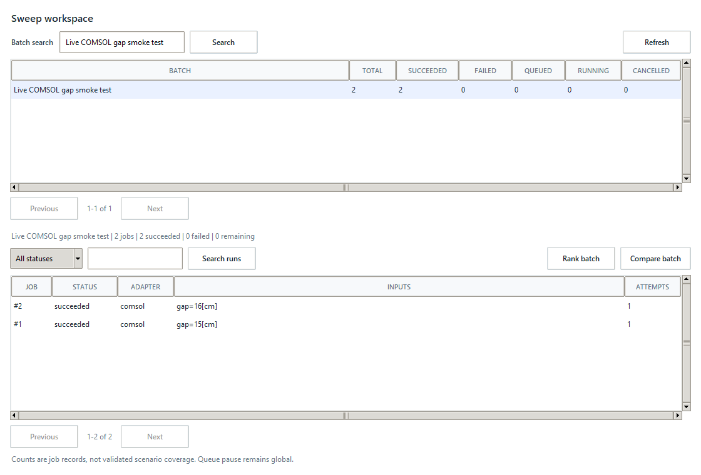
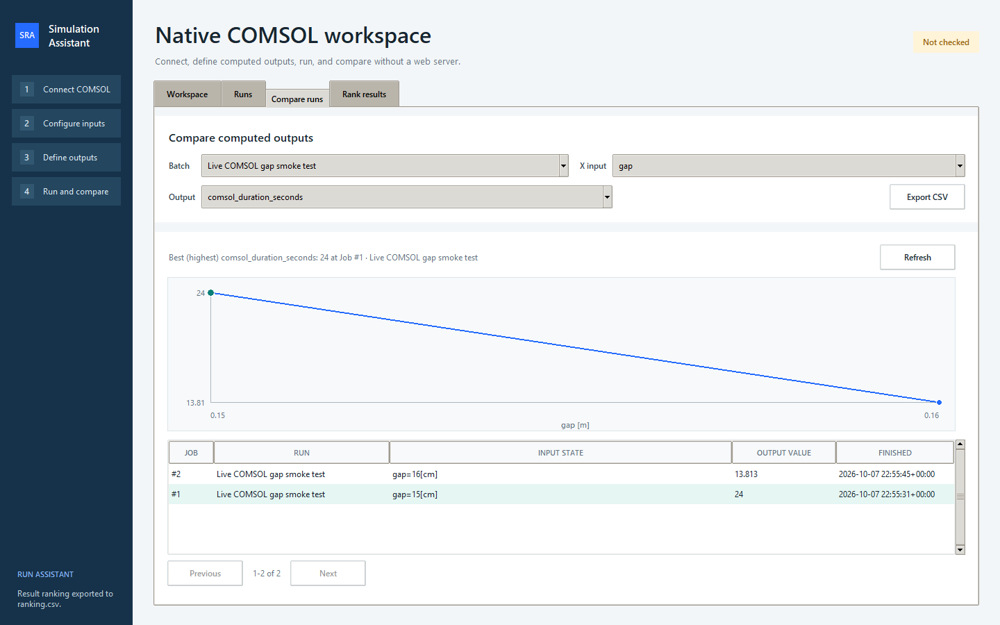
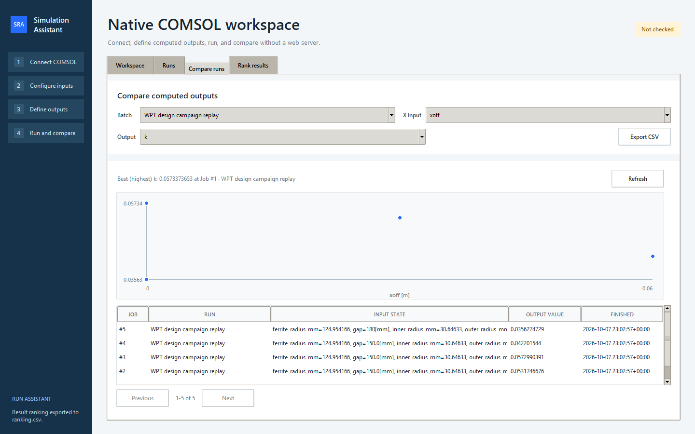

# Scalable sweep workspace

## Scope and acceptance

Browse the complete local job history without running additional simulations.
Group jobs by their existing batch name, search literal names, and page through
batch summaries and individual runs. Summaries count job records, not unique
physical scenarios; reusing a name combines its records and does not certify
model compatibility or scientific validity.

Numeric Compare runs and Rank results must query the selected batch before
reading results. Options, best values and CSV exports include every matching
successful job, not only the most recent 500 or the visible page. Ranking keeps
its existing constraint and scientific-validation rules. Render at most 100
table rows per page. The recent queue view remains a recent-history shortcut.

The workspace opens existing run details, where established retry/stop controls
remain available. Queue pause stays global. This increment does not change
solver scheduling, the 500-case submission safety limit, source models, or the
specialized Pareto/robust/reference/campaign analysis workflows.

## Verification contract

- Isolated SQLite fixtures include old batches hidden behind thousands of newer
  jobs, all five statuses, literal wildcard characters and invalid page inputs.
- Read APIs use parameterized SQL, bounded pages and streamed full-scope reads.
  Page count and items share a read snapshot; refresh observes later changes.
- Native desktop checks exercise old-batch discovery, page navigation, complete
  comparison/ranking exports, empty filters and keyboard access to run details.
- Stored COMSOL replay and any new live solve are reported separately from
  synthetic stress tests. Original MPH files and production queues are untouched.
- Full regression tests, package build and content review precede publication.

## Use

Open the desktop app with `sim-assistant desktop`, choose **Runs**, then
**Sweep workspace**. Search a batch name, select it and filter its runs by status
or search text. Use Previous/Next to browse all matching records. Double-click a
run or press Enter to open its details. **Compare batch** and **Rank batch** open
the existing numeric analysis tabs with that exact batch selected.

Search is case-insensitive and literal, including `%` and `_`. Run search matches
the ID, batch name or serialized input parameters. Refresh updates live counts;
the workspace does not automatically start or stop any solver. CSV exports in
the analysis tabs include the full current analytical result, not just its page.

Large analytical results still require memory proportional to matching rows for
sorting and export. Select one batch to reduce scope. Pagination bounds native
table rendering, not the numerical computation. Comparison is descriptive;
ranking applies the existing scientific rejection and constraint checks.

The overview chart shows at most 1,000 markers. Larger sets are explicitly
labelled as sampled, preserve x endpoints and y extrema, and do not connect
sampled points with an interpolating line. Axis bounds use the full data.
Comparison highlights the highest value descriptively; that does not mean
maximum duration, loss or current is desirable. Use Rank results with Minimize
when a smaller objective is preferable.

CSV keeps ordinary input column names. Inputs colliding with reserved result
columns receive an `input:` prefix (repeated if needed). Formula-like text in
cells or headers receives a leading apostrophe so spreadsheet tools treat it
as text. Numeric negative values remain numeric. Check confidential input
names and values before publishing an export.

## Reproduce the desktop check

Install the project, then run from its repository:

```powershell
python examples/check_sweep_workspace_ui.py
```

This creates a temporary isolated database, replays five published 3D WPT
results and adds 10,000 clearly labelled synthetic records. It verifies full
exports, bounded tables, minimum/normal layouts and Enter-to-open details.
No COMSOL installation is needed for replay. Tk and a graphical desktop are
needed for native checks; headless CI still runs the database/logic tests.

For an optional new live smoke test with a compatible COMSOL installation:

```powershell
python examples/check_sweep_workspace_ui.py --model "C:\Models\wireless_transfer.mph" --workspace ".sim-assistant\sweep-check"
```

Choose a new workspace. This command solves two copies using the model's first
study and gap values `15[cm]` and `16[cm]`; it requires a `gap` parameter and
uses two cores with a 300-second timeout per solve. Use it only when these
values are appropriate for your model. Original-file hashes are checked before
and after. `output.mph` and solver logs remain under the chosen isolated
workspace. This smoke test does not establish fresh two-port efficiency data.

Optional screenshots require Pillow in the check environment, not as an app
dependency. Add `--capture-dir docs/images/my-check` to capture actual native
windows. `--replay-workspace .sim-assistant/sweep-check` rechecks a previously
created check database without new solves; do not point it at a production queue.

## Recorded verification, 2026-10-08

All 237 regression tests passed locally, including 15 new workspace tests.
The 0.31.0 wheel built successfully. Native checks require a graphical desktop;
their isolated database/logic counterparts also run headlessly.

The original `wireless_transfer.mph` was preserved with SHA-256
`4d6c11bdf183f7ccfdbf8df882db18bd5ec82db4908c1ef287901175c631d1a7`.
Two new COMSOL study solves succeeded on copies:

| Gap | Degrees of freedom | Adapter elapsed (s) | Solver-reported run (s) |
| --- | ---: | ---: | ---: |
| 15 cm | 2,686 | 24.000 | 3 |
| 16 cm | 2,690 | 13.813 | 3 |

Elapsed includes batch startup and output handling; these two timings are not
a controlled solver-performance benchmark. The model has no configured fresh
result-table job sequence, so only solver diagnostics were used for this check.
No physical efficiency or delivered-power result is inferred from these numbers.





A separate check replays five published 3D WPT two-port outputs. The screenshot
below compares their coupling coefficient `k` with lateral offset normalized to
metres. Gap and tilt also vary in these cases, so this is not an offset-only
controlled experiment. These are stored simulation results, not new solves or
hardware measurements.



Each check places its genuine/stored results behind 10,000 newer synthetic job
records to verify old-history discovery. Desktop initialization measured about
0.6 seconds locally with small fixture payloads. Larger real result payloads
can cost more; no universal timing guarantee is made.
