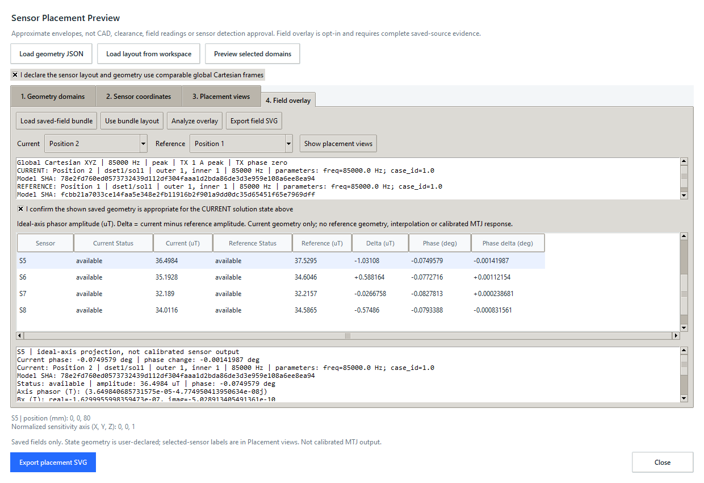
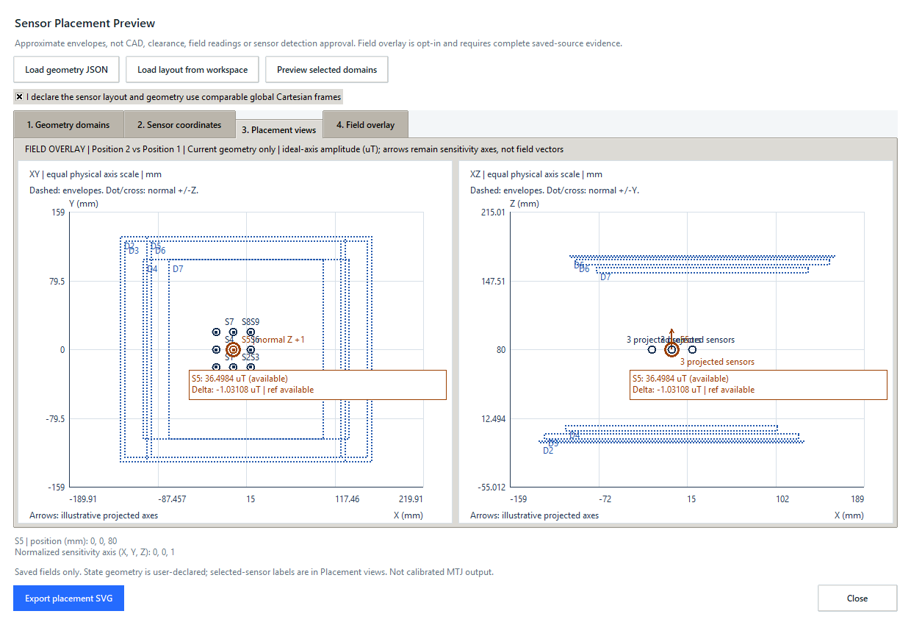

# Sensor Field Overlay

## Objective and scope

Connect saved complex field samples to the existing Sensor Placement Preview.
Show current/reference axis-projection amplitude in uT and signed amplitude
change at fixed sensors, with selectable Bx/By/Bz real/imaginary values and phase.
No new COMSOL solve, model edit, interpolated heatmap, calibrated MTJ response,
position estimator or hardware controller. Python 3.10+, standard library only.
The approved placement sketches remain approximate envelopes, not CAD.
This is not calibrated MTJ output or evidence of vehicle-position detection.

## Desktop walkthrough

1. Run `sim-assistant desktop`, then open **Runs > Field samples > Sensor
   placement** (or the same action in Geometry inspector). Existing applied
   layout/geometry inputs are independent copies, not live editor bindings.
2. Load a geometry snapshot JSON, not an MPH file. Select the desired domains
   in **Geometry domains**. Inspect domain tags against your model; the app
   does not infer TX/RX roles from IDs. Geometry inspector can read your saved
   model through its separate read-only workflow and export this JSON.
3. Open **Field overlay > Load saved-field bundle** and select the directory
   containing `fields.csv`, `workspace.json`, `evidence.json` and `COMPLETE`.
   These come from **Sample saved COMSOL fields > Export source bundle** in
   Field samples. Keep the bundle files together; a bare workspace cannot
   establish source association.
4. Loading the bundle preserves your copied layout. Choose **Use bundle layout**
   explicitly to replace it with the sampled positions/directions. Changing an
   axis is allowed; moving/renaming a sensor does not move or interpolate the
   saved samples. Unmatched IDs/positions become unavailable.
5. Choose **Current** and **Reference** scenarios. Read their exact model SHA,
   dataset, solver, outer/inner state, frequency and parameter values in the
   scrollable source panel. Current geometry must share the current model SHA.
   Reference can be another compatible model, but its geometry is not drawn.
6. Review origins, coordinates and orientations, then declare comparable global
   Cartesian frames above the tabs. Separately confirm that the shown geometry
   is appropriate for the **current saved solution state**. Do not check this
   merely because the MPH hashes match: a saved parameter sweep can retain
   geometry different from a historical solution's geometry. If unsure, inspect
   the actual solved state in COMSOL first; the app cannot prove this mapping.
7. Choose **Analyze overlay**. The table shows current/reference amplitudes in
   uT, signed amplitude difference and phase/phase difference in degrees. Select
   a row with the mouse or keyboard to see exact complex Bx/By/Bz in tesla and
   ideal-axis phasors. True zero has undefined phase, not a guessed zero phase.
8. Choose **Show placement views**. The selected sensor has a field annotation
   in XY/XZ. Select another sensor in **Sensor coordinates**, the reading table
   or a plot. Dense/projectively coincident sensors still require exact table
   selection. Arrow lengths show projected sensitivity direction, never field
   strength; envelopes are not coil curves or physical intersection evidence.
9. **Export field SVG** includes both views, the complete numeric/component
   record and source/state/digest metadata. **Export placement SVG** remains a
   separate geometry-only image. Neither is a reloadable field session. Review
   user labels and parameters for private content before sharing.

Source, layout, domain, frame and scenario changes clear accepted fields and
relevant declarations. Cancelled/failed bundle loads or exports preserve work.
**Preview selected domains** explicitly returns to geometry-only mode and
clears field approval; use Analyze overlay to re-enable it. No setting starts
a solve, edits an MPH, modifies the source layout or changes the run queue.

## Worked saved-result replay

The included pair uses actual stored COMSOL fields and newly read matching
geometry snapshots, not synthetic geometry or hardware measurements. For this
documented pair only, review the source notes below before the explicit flag:

```powershell
.\.venv\Scripts\python.exe examples/replay_sensor_field_overlay.py --desktop --confirm-frame-and-state
```

For an offline export without a window or COMSOL installation:

```powershell
.\.venv\Scripts\python.exe examples/replay_sensor_field_overlay.py --headless --confirm-frame-and-state --output-dir artifacts/field-overlay-demo
```

The output directory receives `sensor-field-position-2.svg`. Existing outputs
are refused, not overwritten. Use `--current 1` to reverse the comparison and
display the aligned model's geometry instead. Omit the flag and replay is
blocked: the demonstration never silently imports a saved approval. The CLI
flag declares both comparable frames and appropriate current-state geometry.
Do not transfer that declaration to an unreviewed model or sweep.

The fixed 3x3 grid is X/Y = -20, 0, 20 mm, Z = 80 mm, sensitivity axis +Z.
Position 1 is aligned; Position 2 has 30 mm RX offset. Both sampled states are
`dset1 / sol1 / outer 1 / inner 1`, `freq=85000 Hz; case_id=1`. Excitation is
TX 1 A peak with TX phase zero. The selected `case_id=1` is the TX-only
excitation state. The source case records keep geometry parameters fixed per
file; those inputs and the saved envelopes were reviewed for this worked
association. Generic hash matching alone still cannot establish historical
sweep geometry.

For S5, current Position 2 is **36.4984380917 uT**, reference Position 1 is
**37.5295187133 uT**, and current-minus-reference is **-1.0310806216 uT**.
This is `abs(n dot B_current) - abs(n dot B_reference)`, not
`abs(n dot (B_current - B_reference))`. Phase differences wrap to [-180, 180).
The declared peak convention is retained; no peak/RMS conversion is guessed.
These are TX-only characterization fields, not loaded charging operation,
a vehicle-body magnetic signature, calibrated MTJ voltage or detection proof.





On 2026-11-12, COMSOL 6.3.0.290 read finalized geometry from private copies of
both original solved models without geometry build, mesh, solve or model save.
Before/after source hashes matched the existing field evidence exactly:

- Position 1: `fcbb21a7033ce14faa5e348e2fb11916b2f901a9dd0dc35d65451f65e7969dff`
- Position 2: `78e2fd760ed0573732439d112df304faaa1d2bda86de3d3e959e108a6ee8ea94`

The portable snapshots are `examples/saved_field_wpt/geometry-position-1.json`
and `geometry-position-2.json`. Domains 2-7 are explicitly selected solids;
the large surrounding air envelope (domain 1) is omitted. Snapshots retain all
seven domains for independent review. No private MPH files/paths are published.
The captures show the real isolated native window, not drawn mockups. Native
checks exercise 1000x760 and 1240x850, selection, resizing, status/detail access
and zero queue/connection changes. Replay uses no COMSOL process or new solve.

Optional `--capture-dir <new-directory>` records actual windows on Windows when
Pillow is already installed; Pillow is not an application dependency. Inspect
the vector export in its destination: fonts are not embedded and dense geometry
or overlapping sensor projections can require the authoritative numeric table.

## Evidence and acceptance contract

- Read existing complete saved-field bundles: only known `fields.csv`,
  `workspace.json`, `evidence.json` and `COMPLETE` files, bounded to 5 MB, 8 MB,
  500 kB and 128 bytes. Reject leaf symlinks, duplicate JSON fields, unsupported
  schemas/fields, non-finite values, malformed states and inconsistent hashes.
  Parse the exact bytes read once; do not follow paths from JSON or fetch URLs.
- Support existing single-source `wpt.saved-field-evidence.v1` and multi-source
  `wpt.saved-field-campaign.v1` bundles emitted by the saved-solution sampler.
  Verify CSV/workspace/evidence consistency, per-source canonical CSV hashes,
  source model identity, exact scenario coverage, fixed sample coordinates,
  saved dataset/solver/outer/inner/frequency and compatible Cartesian expressions,
  frame, units, excitation, phase reference and peak/RMS convention. A bare
  workspace or a synthetic CSV cannot establish this provenance.
- Keep immutable copied data, source states and evidence digests. Hashes prove
  consistency only, never authenticity or physical correctness. Unknown source
  association blocks merged overlay rather than assigning a guessed model.
- Select current and reference scenarios explicitly. Require the displayed
  geometry snapshot's source SHA to match the **current** scenario's source.
  Reference fields may come from another compatible model; the plot shows only
  current geometry, never inferred reference geometry.
- Require the existing comparable-frame declaration and a separate fresh user
  declaration that the shown saved geometry is appropriate for the current
  solution state. Matching MPH hashes alone do not prove historical sweep-state
  geometry. Show exact state identifiers/parameters for review. No automatic
  registration or geometry reconstruction.
- Reuse ideal-axis complex projection/reference semantics with robust normalized
  3D axes. Match exact sensor IDs and positions within the existing 1e-9 m
  tolerance. Missing points/position mismatches have unavailable readings;
  missing reference is not zero. A true zero amplitude has undefined phase.
- Selecting a sensor synchronizes plots, the numeric comparison and component
  detail. Annotate the selected sensor to avoid dense overlapping value labels.
  No color interpolation, smoothing or field-strength direction arrows.
- Source, layout, geometry, domains, frame or scenario changes invalidate
  merged results/exports and relevant declarations. Failed/cancelled loading
  preserves accepted work. Geometry-only preview/export remains available.
- Export a static SVG with both views, explicit units/conventions, current-only
  geometry warning, numeric readings including unavailable states, complex
  components, source/state records and digests. Use the existing atomic SVG
  writer and escaped XML; no automatic local paths or MPH payloads.

## Native design and structure

Add a focused Field overlay tab/controller to the existing independent placement
window, not a second competing sensor editor. Load bundle data without opening
MPH. Preserve an existing copied layout; expose an explicit Use bundle layout
action for replacement. With no layout, the same action supplies one. Field
samples can still open the placement window; evidence loading is separate and
mandatory for merging. Keyboard/table selection and geometry-only entry points
must retain their existing behavior and minimum-window usability.

Pure bundle parsing lives in `saved_field_bundles.py`; projection/binding in
`sensor_field_overlay.py`; focused drawing/export in `sensor_field_views.py`;
native controls in `sensor_field_ui.py`. Reuse pure bounded field CSV/workspace
parsers, source validators, layout and placement primitives. Frozen dataclasses,
snake_case, ValueError for invalid external input; OSError for filesystem failures.

```python
bundle = load_saved_field_bundle('saved-field-example')
overlay = analyze_overlay(snapshot, sensors, bundle, current, reference,
                          comparable_frames=True, geometry_matches_state=True)
```

## Verification and boundaries

First prove exact-byte parsing and existing format compatibility; then malformed
bundle/source attacks; then source/state gates and missing/complex/zero reading
semantics; then SVG and native stale-state/selection/resize/error handling.
Replay stored fields with genuinely matching geometry when available. Do not
relabel unrelated geometry as a match or fabricate source hashes for a real
example; synthetic fixtures must remain explicitly synthetic test data.

```powershell
.\.venv\Scripts\python.exe -X utf8 -m unittest discover -s tests -v
.\.venv\Scripts\python.exe -X utf8 -m compileall -q src tests examples
.\.venv\Scripts\python.exe -m pip wheel . --no-deps --no-build-isolation -w dist
sim-assistant desktop
```

The workflow preserves source models and the existing queue/database. It adds
no runtime dependency or schema migration. Pending sensor datasheets and vehicle
field definitions do not become assumptions in this feature. Publishing a
repository update is separate from running the saved-result replay.

The 2026-11-12 local verification passed all 450 tests, compilation and the
dependency-free wheel build. Eight affected runtime modules matched the built
wheel bytes; isolated installed-package native/headless replay also passed.
Checks cover single/campaign source bundles, corrupt evidence, exact complex
values, robust axes, zero/undefined phase, missing/mismatched points, explicit
declarations, stale-state clearing, cancelled/failed I/O and real paired sources.
No claim is made about arbitrary model structures, scientific convergence or
calibrated sensor detectability.
