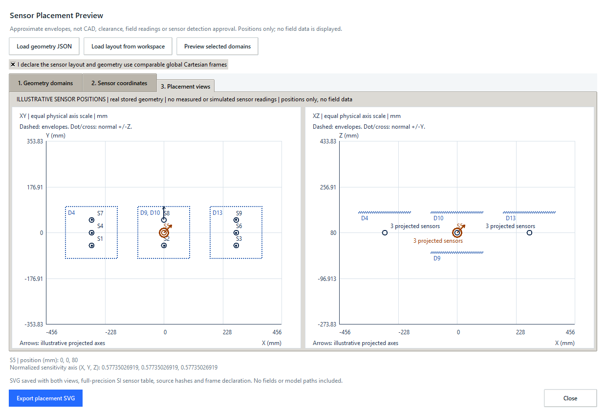
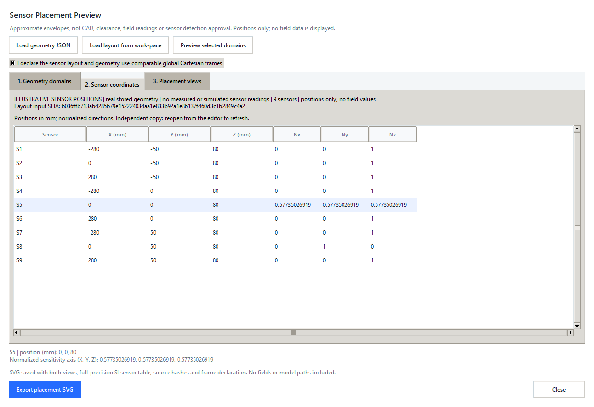

# Sensor Placement Preview

## Objective and approved scope

Review fixed sensor positions and directions alongside explicitly selected
saved geometry envelopes in XY and XZ. This is a read-only placement sketch,
not a field map, CAD view, collision/clearance check, calibrated sensor response
or controller result. No MPH file is opened, modified, rebuilt or solved.
Python 3.10+, Tk/ttk and the standard library only; no dependency or schema change.
This guide describes geometry-only mode. The separate opt-in
[Field overlay workflow](SENSOR_FIELD_OVERLAY.md) can display saved fields only
after evidence validation and fresh frame/current-state declarations.

## Desktop walkthrough

1. Run `sim-assistant desktop`. Open **Runs > Geometry inspector > Sensor
   placement** to copy the current snapshot, or **Runs > Field samples > Sensor
   placement** to copy an applied sensor layout. Unapplied sensor edits block
   opening a preview. Closing the source editor leaves the preview intact.
2. In the preview, use **Load geometry JSON** if no snapshot is loaded. These
   are saved geometry snapshots, not MPH models. In **Geometry domains**, use
   Ctrl/Shift-click to select the envelopes to show. Check their selection tags
   against the source model; domain IDs never prove a coil's identity.
3. Use **Load layout from workspace** to copy positions/directions from an
   existing Field samples workspace. To define a new layout without field data,
   open Field samples, use the Sensor layout editor or its explicit grid action,
   apply edits and choose **Sensor placement**. No field CSV is needed for this
   editor-to-preview path. A field workspace's readings are not visualized here.
4. Review units, origins, axes and orientation before checking the comparable
   global Cartesian frames declaration. A metadata label or matching numbers
   does not prove registration. Select **Preview selected domains**.
5. The **Placement views** tab shows XY and XZ with X right and Y/Z up. Both
   axes within a panel have equal physical scale; panels fit independently.
   Dashed rectangles are approximate global envelopes, not actual coil curves.
   Coincident domain projections share a label. Projectively coincident sensors
   show a count; select an exact sensor in **Sensor coordinates** to show its
   direction. A dot/cross means a positive/negative omitted-axis component for
   a fully normal axis, not a zero reading. An almost-normal axis is labeled
   when selected. Arrow/marker sizes are illustrative, not physical lengths.
6. Click a sensor marker or select a sensor row with the keyboard. The same
   selected ID is highlighted in both views. Close markers within the picking
   radius can be ambiguous; the table is authoritative. Plot IDs may be
   shortened and dense plots label only the selected ID. Full IDs, positions
   in mm and normalized directions remain in the scrollable table; displayed
   numbers use 12 significant digits.
7. Select **Export placement SVG**. The image contains both views, hashes,
   explicit selected domains, the declaration and a full-precision sensor table
   in SI metres with normalized unitless axes. It is a static vector image for
   reports/slides, not a reloadable session, CAD model or scientific approval.
   SVG fonts depend on installed fonts; inspect it in the destination app.

Replacing geometry/layout or changing selected domains clears frame approval
and export eligibility. Unchecking/rechecking frames clears the accepted sketch;
choose Preview again. Failed loads/exports preserve current work. The preview
does not edit or autosave source layouts; reopen from the editor to refresh.
No new comparison-session schema, automatic file monitoring or registration is
introduced. Loading a layout does not prove it belongs to the geometry model.

## Contract and design decisions

- Reuse validated geometry snapshots and applied `Sensor` tuples (1-256).
  A field workspace can supply its layout; field readings are not imported into
  this preview. Copy inputs into an independent window; reopen to refresh from
  an editor. No external-file monitoring is implied.
- Select 1-256 geometry domain IDs explicitly. No ID or selection name assigns
  a TX/RX/ferrite/shield role automatically. Labels show domain IDs and the
  source selection tags remain available in the selection table.
- Require a fresh explicit declaration that sensor coordinates and geometry
  use comparable global Cartesian frames. Unit conversion to SI is already
  complete, but is not registration. Loading/replacing either source clears
  approval, accepted drawings and export eligibility. Failed loads preserve
  current inputs. No saved approval is imported.
- Use equal physical horizontal/vertical scale within each view; disclose that
  the XY and XZ panels fit independently. Include every sensor and selected
  envelope in the limits. Display coordinates in mm. Marker and arrow lengths
  are illustrative screen sizes, not sensor size or field magnitude.
- Normalize the full 3D sensitivity axis, then project it without renormalizing
  in 2D. A normal-to-plane axis is labeled explicitly rather than shown as a
  zero or an arbitrary in-plane arrow. Coincident projected sensors remain
  selectable through the numeric table; no depth or physical intersection is
  inferred from projected overlap. Dense views label only the selected sensor.
- Keep numeric sensor coordinates and normalized directions in a scrollable
  table. Selection by keyboard or plot highlights the same ID in both views.
- Export a static, escaped SVG with both projections, a numeric sensor table,
  selected domains, source MPH and snapshot-content hashes, layout-content
  hash and the explicit frame declaration. No automatic local source paths,
  raw fields, private model contents or inferred engineering approval. Review
  user labels/tags before sharing. Reject wrong suffixes and use atomic writes.

## Structure and style

Pure projection/view calculations live in `sensor_placement.py`; SVG and
shared drawing primitives in `sensor_placement_views.py`; focused native
widgets/controller in `sensor_placement_widgets.py` and `sensor_placement_ui.py`.
Existing Geometry inspector and Field samples actions open independent previews.
Use frozen dataclasses, snake_case and ValueError boundary checks, for example:

```python
view = project_placement(snapshot, sensors, (4, 9, 13), 'XZ',
                         comparable_frames=True, width=580, height=420)
```

## Verification and boundaries

First test numeric transforms, equal scale, extreme/degenerate layouts, axis
projection and frame/source validation. Then test escaped, self-contained SVG
and write failures. Then verify native source loading, explicit selection,
stale approval/export protection, plot/table selection, keyboard access,
minimum/normal window sizes and independent editor entry points. Finally replay
existing real stored geometry with clearly illustrative sensor locations,
capture actual native windows, run full regressions, compile and build/install.

```powershell
.\.venv\Scripts\python.exe -X utf8 -m unittest discover -s tests -p "test_sensor_placement*.py" -v
.\.venv\Scripts\python.exe -X utf8 -m unittest discover -s tests -v
.\.venv\Scripts\python.exe -X utf8 -m compileall -q src tests examples
.\.venv\Scripts\python.exe -m pip wheel . --no-deps --no-build-isolation -w dist
sim-assistant desktop
```

Always retain data, warnings, source identity and English UI/docs. Ask before
new dependencies, schemas, solves or external publication. Never infer geometry
roles, sensor detection capability or safe spacing from this sketch. No commit,
push, release, field overlay, automatic registration or MTJ transfer model is
part of this implementation request.

## Worked real-geometry example

The [saved Original/Overlap/Control geometry snapshots](../examples/saved_geometry_wpt/README.md)
were measured previously from actual saved models. This replay explicitly
selects D4, D9, D10 and D13, whose coil-envelope roles are known for those exact
fixture hashes. These IDs must not be generalized to other models.

The **nine sensor positions and axes are illustrative**, defined by the replay
script, not extracted hardware placements, COMSOL sensor readings or a proposed
optimum. X = -280, 0, 280 mm; Y = -50, 0, 50 mm; Z = 80 mm. Most axes are +Z;
S5 uses `(1,1,1)` normalized and S8 uses +Y to exercise both in-plane and normal
directions. No magnetic field, electrical result or detectability is evaluated.

```powershell
python examples/replay_sensor_placement.py --headless
python examples/replay_sensor_placement.py --geometry overlap --headless
python examples/replay_sensor_placement.py --geometry control --headless
python examples/replay_sensor_placement.py --desktop
python examples/replay_sensor_placement.py --headless --output-dir artifacts/placement-example
```

Headless replay needs no Tk/COMSOL or license. Native replay uses a disposable
queue. An optional output directory retains SVG but an existing image is never
overwritten by the replay. `--capture-dir` records actual native windows on
Windows if Pillow is already installed; it is not an application dependency.

[Download the worked SVG with full numeric/provenance evidence](images/sensor-placement/sensor-placement-original.svg).

Actual native-window captures, without retouching:




