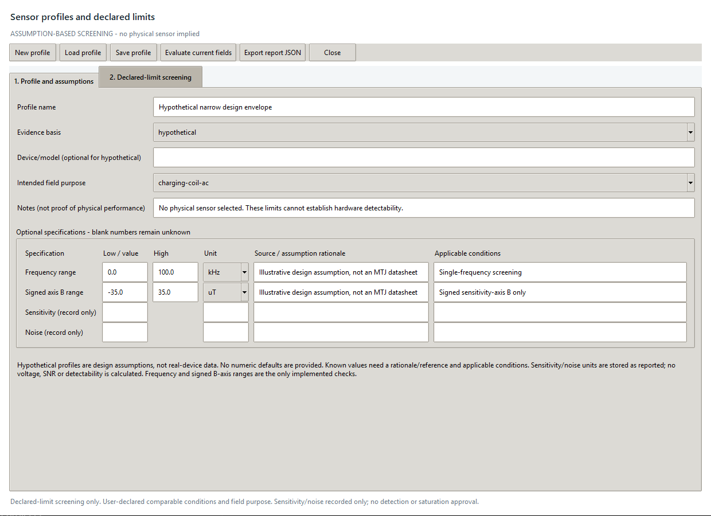
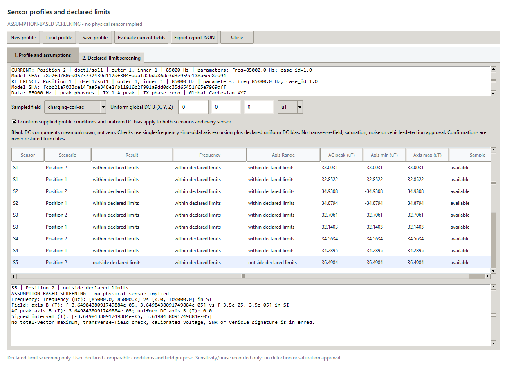

# Sensor profiles and declared-limit screening

## Objective and scope

Review fixed-axis saved field results against explicitly entered design limits.
A physical sensor or datasheet is optional: the default is a **hypothetical**
design profile, never an invented real MTJ device. A **documented** profile
records a device/model and user-supplied references; the application does not
authenticate those references. Unknown specifications stay null, not zero.
Sensitivity/noise are recorded with units and conditions only. No calibrated
voltage, noise integration, SNR, saturation model, vehicle detector or controller.
No source MPH operation, new solve, queue/database change or new dependency.

## Desktop walkthrough

1. Run `sim-assistant desktop`. Open **Runs > Geometry inspector > Sensor
   placement > Field overlay > Sensor profiles**. This route opens an empty
   workspace without needing an MPH, geometry snapshot, field data or sensor
   hardware. From Field samples, apply a valid layout before opening Sensor
   placement; the same Sensor profiles action is then available.
2. Keep **Evidence basis = hypothetical** for design exploration. Give the
   profile a name and leave the device blank if none is selected. Documented
   mode requires a device/model name; it remains a user-recorded claim, not
   independently verified evidence. Choose the intended field purpose explicitly.
3. Leave unknown specifications blank. To enter a known or assumed range,
   supply both numeric bounds, a unit, a source/assumption rationale and applicable
   conditions. Frequency is a range, not just an upper bandwidth number. Signed
   axis B bounds refer to instantaneous field along the sensitivity axis, not
   total-vector magnitude. Sensitivity/noise values and their reported units
   are stored for context only; the app does not convert them into voltage/SNR.
4. **Save profile** writes portable JSON and does not approve conditions or
   evaluate fields. **Load profile** restores only declarations; sampled-field
   purpose, bias and confirmation must be supplied again. New/load/close ask
   before discarding a dirty profile. Closing the parent placement window also
   protects unsaved profile edits. Failed/cancelled file actions preserve work.
5. To screen saved fields, first create an accepted **Field overlay** using the
   [overlay guide](SENSOR_FIELD_OVERLAY.md). Review exact current/reference
   sources and states. Open the profile's **Declared-limit screening** tab and
   declare the actual sampled-field purpose; the app never infers vehicle
   signature from charging-coil results.
6. If known, enter a **uniform global DC B vector** in X/Y/Z with T/mT/uT units.
   All three components are needed. Entering `0,0,0` is an explicit zero-bias
   assumption, not an inference from saved AC fields. Leave all blank if unknown.
   A single vector applies to both scenarios and every sensor; spatially varying
   or scenario-dependent bias is not modeled here.
7. Confirm that the supplied conditions and uniform-bias assumption apply, then
   choose **Evaluate current fields**. Unconfirmed/non-comparable context can
   still be evaluated as an explicitly insufficient-information report. Known
   profile limits and the actual saved phasor convention govern each numeric
   check. A valid frequency result alone cannot approve an unknown field range.
8. Select a row to inspect exact numeric reasons, peak axis excursion, signed
   bias and the checked interval. Both current and reference appear independently.
   Tables scroll horizontally/vertically; long source details are scrollable.
   The top scope label remains explicit about hypothetical/documented claims.
9. **Export report JSON** includes the profile, original field comparison,
   complex components, all assumptions/unknowns, exact states and source hashes.
   It is a static evidence report, not a reloadable session or approval. Review
   user-entered text for private information before sharing. Editing profile,
   context or accepted source inputs clears assessment and fresh confirmation.

## Worked example without a datasheet

Two portable profiles are provided:

- [Blank hypothetical profile](../examples/sensor_profiles/blank-hypothetical.json):
  no selected device, numeric values or intended field. It is intentionally unknown.
- [Illustrative design envelope](../examples/sensor_profiles/hypothetical-design-envelope.json):
  an assumed 0-100 kHz frequency range and -35..+35 uT signed axis range. These
  numbers demonstrate the workflow; they are not real sensor specifications or
  recommended design targets. Sensitivity/noise remain unknown.

Use the existing saved COMSOL pair and matching geometry, without a new solve:

```powershell
.\.venv\Scripts\python.exe examples/replay_sensor_profiles.py --desktop --case narrow --confirm-assumptions
```

The explicit flag confirms the reviewed example's frame/state association,
charging-coil purpose, hypothetical limits and an illustrative uniform-zero-DC
assumption. Do not copy this approval to another model or measurement. The
`unknown` case deliberately keeps DC bias unknown. Ordinary new profiles never
start with the example's numeric limits, purpose, zero bias or approvals.

For traceable offline reports:

```powershell
.\.venv\Scripts\python.exe examples/replay_sensor_profiles.py --headless --case wide --confirm-assumptions --output-dir artifacts/profile-wide
.\.venv\Scripts\python.exe examples/replay_sensor_profiles.py --headless --case narrow --confirm-assumptions --output-dir artifacts/profile-narrow
.\.venv\Scripts\python.exe examples/replay_sensor_profiles.py --headless --case unknown --confirm-assumptions --output-dir artifacts/profile-unknown
```

Each case writes `profile-<case>.json` and `assessment-<case>.json`; pre-existing
outputs are refused. Individual files are atomic, not a two-file transaction.
No COMSOL installation or license is needed for offline replay. The native
window uses Tk; optional `--capture-dir <new-directory>` needs existing Pillow
on Windows only for actual screenshots, not for ordinary application use.

- `wide`: -100..+100 uT assumed axis range; these stored readings lie within it.
- `narrow`: -35..+35 uT assumed range; S5 at Position 2 has about 36.4984 uT AC
  peak along +Z, so it lies outside that assumed interval with the declared zero
  bias. This is a bound violation in an assumed model, not proof of saturation.
- `unknown`: the same narrow profile but unknown DC bias; axis range and overall
  results remain insufficient even though frequency can be checked.

The fields are actual previously extracted TX 1 A peak characterization results,
85000 Hz, `dset1/sol1/outer 1/inner 1`, Position 2 versus Position 1. They are
not loaded charging operation or vehicle-body magnetic signatures. No physical
MTJ is implied. Matching geometry/source details are in the overlay guide.





## Contract and implementation plan

This is one screening capability, built in dependency-ordered slices:
immutable profile/JSON roundtrip, pure limit screening, report export, native
profile workflow, then documented worked examples and full verification.

- `sensor_profiles.py`: frozen `SensorProfile`, `StatedRange`, `StatedValue`.
  Profile name, optional device, basis (`hypothetical`/`documented`), intended
  field (`unknown`, `charging-coil-ac`, `vehicle-signature`), notes; optional
  frequency range, signed sensitivity-axis B range, sensitivity and noise.
  Known values require a source/assumption rationale and conditions. Documented
  mode requires a named device. Numeric fields start blank in either mode.
  Frequency units Hz/kHz/MHz; B units T/mT/uT, not H units or Oe. Sensitivity/noise
  units are retained as reported, not interpreted or converted. Finite literal
  numbers only; booleans, invalid bounds, units and malformed shapes rejected.
- `sensor_profile_files.py`: bounded 256 KiB, strict duplicate/unknown-field
  rejection and nested validation for `wpt.sensor-profile.v1` JSON, canonical
  checksum, atomic writes via existing geometry file helpers. No persisted
  approvals, external paths opened from metadata, URL fetches or executable data.
- `sensor_limit_checks.py`: evaluate an already accepted `SensorFieldOverlay`.
  Require separately declared sampled-field purpose and fresh confirmation
  that supplied profile conditions and uniform DC bias apply to both scenarios
  and all fixed sensors. Different/unknown purposes are non-comparable, not an
  inferred vehicle signal. Profile assumptions remain explicitly labelled.
  Supported checks are declared frequency and signed axis-field range only.
- DC bias is an optional **uniform global XYZ vector in T**, manually supplied;
  all blank means unknown, not (0,0,0). Project it onto the robust normalized
  sensor axis. For a single sinusoidal phasor, peak axis excursion is `abs(n.B)`
  for peak convention, `sqrt(2)*abs(n.B)` for RMS convention. Check the inclusive
  interval `[n.Bdc - peak, n.Bdc + peak]` against the declared signed B range.
  Do not infer DC from the AC phasor, total-vector peak from component magnitudes,
  or a loaded operating field from 1 A characterization fields. This is a
  declared single-axis bound, not a guarantee against physical saturation.
- Three results: `within declared limits`, `outside declared limits`,
  `insufficient information`. Known bound violations take precedence over
  missing checks; otherwise any missing/non-comparable condition gives
  insufficient information. Missing sample/position mismatch remains unavailable
  independently per current/reference row. Zero amplitude is a valid zero;
  missing bias still prevents the B-range check. No noise-derived threshold.
- `sensor_limit_reports.py`: atomic JSON report containing embedded profile,
  profile/layout/geometry/bundle digests, exact current/reference saved states,
  units/conventions, explicit assumptions/context, all checks and null values.
  Recompute and compare before export. It is a report, not a reloadable approval.
- Native `Sensor profiles` window opened from Field overlay. Profile editor and
  assessment tabs reuse native styles/tables; load/save works without field data.
  Evaluation uses the current accepted overlay, never stale cached fields.
  Profile/context/source edits clear results and fresh confirmation; failed or
  cancelled I/O preserves work. New/load/close protect unsaved edits. Parent
  placement close also asks before discarding dirty profile input. Old
  geometry-only and field SVG exports remain unchanged.

Python 3.10+, stdlib/Tk, frozen tuples/dataclasses, snake_case, ValueError for
invalid values and OSError for file errors. Reuse existing unit-axis, checksum,
atomic-write, exact-byte source bundle and native table helpers; no generic
specification framework or second sensor-layout editor.

```python
profile = SensorProfile('My design assumptions')  # no numeric defaults
assessment = assess_sensor_limits(profile, overlay, sampled_field='unknown',
                                  dc_bias_t=None, conditions_confirmed=False)
```

## Evidence and scientific boundaries

User clarification (2026-11-16): no sensor/datasheet is available and one may
never be selected. Hypothetical profiles therefore remain a first-class,
fully usable exploratory workflow. A result inside assumed bounds is not
datasheet evidence, calibration, purchase advice or hardware validation.

The single-frequency sinusoidal peak/RMS relation is separate from DC offset;
see the [Analog Devices measurement guide](https://wiki.analog.com/university/tools/m2k/alice/users-guide-m2k).
Noise specifications require frequency/bandwidth and readout context; the
[NVE magnetometer noise note](https://www.nve.com/Downloads/SB-00-101_Noise-in-TMR-NVE-Magnetometers.pdf)
illustrates why a lone recorded density cannot establish integrated noise or
detectability. No numerical device properties from these references are used
as defaults or attributed to the user's design.

## Verification

Unit tests first: unknown/hypothetical/documented profiles, range/unit validation,
strict portable files, exact boundaries, RMS/peak, signed bias/axis reversal,
missing samples/reference/bias/limits, purpose/conditions gates and report
provenance. Real Tk checks cover load/save/draft protection, stale inputs,
selection, resize, error preservation and parent close. Replay existing saved
COMSOL fields with explicitly hypothetical profiles; no new model or solve.

```powershell
.\.venv\Scripts\python.exe -X utf8 -m unittest discover -s tests -v
.\.venv\Scripts\python.exe -X utf8 -m compileall -q src tests examples
.\.venv\Scripts\python.exe -m pip wheel . --no-deps --no-build-isolation -w dist
sim-assistant desktop
```

Always preserve existing tests, English repository text and source models.
Ask before dependencies, migrations, live COMSOL work or external publication.
The replay performs no publication, version change or release operation.

### Local verification record

On 2026-11-16, all 482 tests passed, including real Tk checks without skips.
The dependency-free wheel built successfully and eleven affected runtime
modules matched the installed wheel bytes. All three headless example cases
and the native example passed from an isolated installation. Actual captures
were inspected at 1240x900; native checks also cover 1040x780 and both tabs,
including wrapped help text, stale input, protected drafts and failed/late I/O.
Original field/geometry fixtures and MPH models were not modified; no COMSOL
process, new solve or production run-queue mutation was needed. This verifies
the implemented declared-limit workflow, not a real MTJ or hardware detector.
