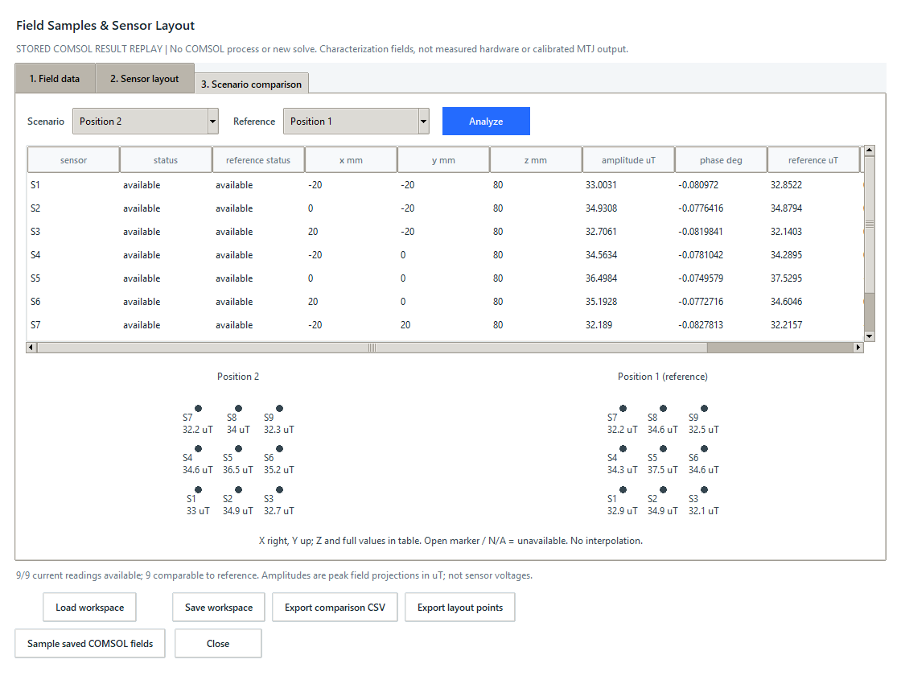

# Saved WPT field example

This example contains actual fields previously extracted from saved COMSOL
solutions, not synthetic readings or measured hardware data. It compares two
solved 3D WPT models: an aligned receiver and a receiver offset by 30 mm.
The private MPH models are not included.

## View the example without COMSOL

From the repository root, using the existing project environment:

```powershell
.\.venv\Scripts\python.exe examples/replay_saved_comsol_fields.py --desktop --output-dir artifacts
```

The native comparison stays open until closed. Its heading explicitly says
**STORED COMSOL RESULT REPLAY**. This mode never launches COMSOL, reads an MPH
file, or uses the production database. It needs no solver license or additional
Python package. Tk is required only for the native window.

For an automated integrity/comparison check without a display:

```powershell
.\.venv\Scripts\python.exe examples/replay_saved_comsol_fields.py --headless --output-dir artifacts
```

Each export creates a new `artifacts/saved-field-...` directory with the checked
source bundle and `comparison.csv`. The included workspace can also be loaded
through **Runs > Field samples > Load workspace** in the ordinary desktop app.
Without `--output-dir`, replay does not persist a new export.

## What the data means

Both sources use `dset1 / sol1 / outer 1 / inner 1`, saved `freq=85000 Hz` and
`case_id=1`. Excitation is declared as `TX 1 A peak`, with `TX phase zero`.
The fixed sensors form a 3x3 grid: X/Y = -20, 0, 20 mm, Z = 80 mm, axis +Z.
CSV fields retain the real and imaginary Bx/By/Bz components in tesla.
The comparison displays the ideal sensor-axis projection amplitude in uT.

| Center sensor S5 | Peak +Z projection |
| --- | ---: |
| Position 1: aligned | 37.5295187133 uT |
| Position 2: RX offset 30 mm | 36.4984380917 uT |
| Position 2 minus Position 1 | -1.0310806216 uT |

These are TX-only characterization fields. They are not loaded charging
operation, calibrated MTJ voltages, a vehicle-body magnetic signature, or
evidence that a physical sensor can detect vehicle position. Mesh convergence,
sensor noise and sensor bandwidth are not evaluated by this example.



## Read your own solved models

`examples/check_saved_comsol_fields.py` is the separate installed-COMSOL path.
Supply two compatible, already-solved Cartesian 3D models and explicit states:

```powershell
.\.venv\Scripts\python.exe examples/check_saved_comsol_fields.py "C:\models\aligned.mph" "C:\models\offset.mph" --executable "C:\Program Files\COMSOL\COMSOL63\Multiphysics\bin\win64\comsolbatch.exe" --dataset dset1 --solver sol1 --outer 1 --inner 1 --prefix mf --convention peak --excitation "TX 1 A peak" --phase-reference "TX phase zero" --z-mm 80 --output-dir artifacts
```

Replace paths, tags, excitation and phase declarations with those appropriate
to your models. This path checks source hashes and reads temporary private
model copies. It does not create a study, change parameters, save the original
MPH, or run a new solve. Do not compare incompatible excitations as positions.

Optional `--capture-dir <directory>` on either script captures actual native
windows on Windows if Pillow is already available. It is not needed for normal
use. Do not combine native capture with `--headless`.

## Evidence and integrity

Keep `fields.csv`, `workspace.json`, `evidence.json` and `COMPLETE` together.
Replay checks bounded file sizes, the CSV/workspace SHA-256 links, the workspace
internal digest, metadata consistency and equality of normalized fields.
Missing, corrupted or inconsistent data is rejected before a window opens.
The source hashes and exact saved states are in `evidence.json`; absolute source
paths are omitted. Git checkout must preserve LF endings in `fields.csv` and
`workspace.json`, as configured by the repository's `.gitattributes`.
Hashes detect accidental corruption; they do not authenticate the source or
scientifically validate the COMSOL models. No MPH files are distributed.

## Verification record

On 2026-10-29, both source models were read again using COMSOL Multiphysics
6.3.0.290. Their original SHA-256 hashes remained unchanged. The newly extracted
CSV and workspace matched the included example byte-for-byte. All nine current
and reference readings were available. CSV export, workspace round trips and
the native sampling window at 980x760/1080x820 passed. Offline replay separately
passed at 980x720/1120x840 without any COMSOL process or production database.
The screenshots show actual native windows from these checks.

This verifies the documented saved-state pair and application workflow, not
arbitrary model structures or scientific convergence of the underlying models.
